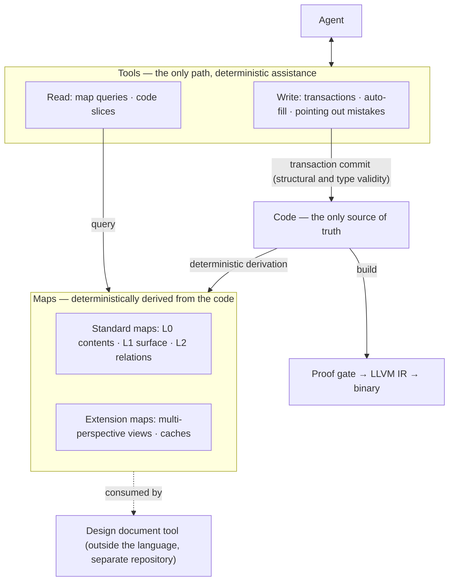

# BMB design principles

> Status: settled version v1.3 · 2026-11-16 (ADR-0142 the model of the language, ADR-0143 the standing of the surface succession) · 2026-11-11 (ADR-0114 the proof context of closures, ADR-0117 the summary of a definition) · 2026-11-09 (ADR-0102 the unit of judgement and the scope of principle 4) · 2026-10-26 (ADR-0045 judgement criteria, ADR-0046~0051 revisions of the language surface and the ledger. v1.1: ADR-0040 revision of premises E1~E3 and principle 4)
> This document holds only the design that is settled now. The reasons for the decisions are in [`adr/`](adr/).

## 1. Definition

**BMB is a language that AI agents write and that is handled with deterministic tools. Its model is the way agents work.**

- **The model is the way agents work (ADR-0142).** As Hangul was modelled on the organs of speech, a form is justified by which property of the way its writer works (a learned distribution, a finite context, probabilistic output, tool calls) it is fitted to.
- **The present surface succeeds Rust and Verus (ADR-0143).** It is a means of making up for the fact that language models have not been trained on BMB, and it is not the definition. Where means that do not lean on the learned distribution (reference and examples in the context, tools, diagnostics) are sufficient by measurement, those means come first and the form follows the model.
- **The semantics are stricter.** BMB gives up even what Rust and Verus kept for human convenience, and in return gains verification, navigation and performance.
- **The compiler is an independent implementation.** It does not use rustc, and performs everything itself from parsing through the proof gate to LLVM IR generation.

| Pillar | Content | Basis |
| --- | --- | --- |
| Compiler | Parsing of the extended grammar, type checking, ownership checking, verification condition generation and the proof gate, profile checking, map derivation, LLVM IR generation | Own + Z3 + LLVM. References: Verus (verification design, ghost code erasure), Rust (semantics) |
| Grammar | Rust grammar + Verus-family specification grammar (`requires`·`ensures`·`spec fn`·`decreases` and so on) + minimal extensions (effects, rationale, proof context, organizational units) | Rust and Verus as references, independent implementation |
| Tools | Maps (L0~L2 + extensions) and read and write tools. The agent's only access path | Own |

**The language's responsibility extends to the code and the maps.** Design documents and diagrams for humans are the job of a separate tool that consumes the maps. This tool is also built by the project, but lives in a separate repository, and Markdown output is its first priority.

## 2. Premises and goals

**Premises**

- **E1.** Line-by-line reading cannot keep up with the output of AI. What humans review moves from code to intent and specification.
- **E2.** The bottleneck of AI coding is not generation but verification and navigation.
  - Verification: (a) the lack of an oracle, in that passing tests does not guarantee a correct answer, (b) review cost that cannot keep up with the output, (c) test cost that is run again on every change and accumulates as number of changes × number of tests (it grows as AI raises the frequency of PRs and pushes), (d) whether the specification matches the intent (specification validity).
  - Navigation: the cost of finding where to fix and what is affected in a large codebase.
- **E3.** A trade that pays a cost once at writing time (writing specifications and proofs, including the cost of a surface that was not learned) to reduce the verification cost repeated on every change and the defects that escape is a gain. Profit and loss are measured by total tokens, accumulated execution cost and defect rate.

The decision that revised the premises against external evidence is ADR-0040.

**Goals**

- **Correctness is a constraint.** If it is not satisfied, there is no build.
- **Performance is the objective function.** It is maximized within the correctness constraint.
- Scalability to large projects and development speed must follow as results of the two goals above.
- **The user is the agent.** AI friendliness is not a goal that competes with the other goals; it is this definition itself.
- **The language that agents want to write is built by measurement (ADR-0142).** The evidence is not self-report but the measurement of friction and benchmarks. When comparing with a learned language, the cost of the design and the cost of not being learned are reported separately, and the design is not judged by a difference that was not separated. Evaluation is done with the language models and means that can be used now, and a dedicated language model or outside adoption is not taken as a premise (ADR-0143).

**Trade-off ledger (ADR-0041)**

| Category | Items |
| --- | --- |
| Maximized | Highest stability (correctness) and performance, least test code, highest AI coding efficiency (total tokens, navigation, writing), smallest binary size, highest code reuse, highest determinism and change safety, least runtime dependency |
| Accepted | Hard to learn and write, the first build takes long (maps, full proof), builds take somewhat long (proof), limited expressiveness (only what cannot in principle be an object of proof goes through an escape hatch with a rationale, and the only intended strictness is what is in the §4.1 ledger. ADR-0045), external toolchain (Z3, LLVM), no ecosystem at first |
| Rules | Reading and writing go through the tools (editing code files directly is discouraged), one expression and one normal form, an escape hatch requires a rationale |

- Tests are handled not by reducing their execution (selection, caching) but by making them unnecessary to exist (structural removal).
- The unit of judgement for the accepted writing cost is not a single write but the total tokens of the whole task.
- The judgement has two layers (ADR-0102). The task unit (G5) is reported as the trajectory of cost, and the judgement of premise E3 is made by the lifetime unit (G5-L: the total tokens of writing + later changes + defect repair, and the accumulated verification cost) and by the rate of escaped defects.
- Each maximized axis has a metric (ADR-0041 §2), and an axis without a metric is not claimed.

## 3. Principles

1. **Code is the only source of truth.** Storage is text files, and the tools decide the file layout deterministically. The storage format itself does not matter.
2. **A map is a derivative that is deterministically derived from the code.**
   - There can be several, one per use (navigation, cache, cost reduction, other concerns).
   - The standard navigation maps L0~L2 are fixed in the specification, and the rest are extension maps.
   - A map is not a copy of the code but a way to the code. When detail is needed, go to the code.
3. **Intent is enforced by declaration.** A contract that holds a quantifier is written as a named predicate (a contract without a quantifier is an expression in the clause, ADR-0095), and the prose of intent and rationale is bound to a node hash. Intent is not inferred backwards from the implementation.
4. **Proof replaces tests.**
   - Without a proof there is no binary.
   - A proof is paid for once. Only the changed definitions and the definitions that rely on their contracts are proved again (proof cache, incremental build). It does not run all over again on every change as tests do.
   - The compiler computes the area that needs tests, reports it as a metric and minimizes it.
   - The scope of replacement is the functional correctness of a single program (unit level). Tests of integration, of trust boundaries (external input, the solver and the compiler themselves) and of configuration outside the code remain.
   - What is replaced is the pure core (`pure` definitions). Definitions with the `io` effect (the shell) remain as test area, and the compiler computes that area (ADR-0102, H-EFFECT refuted).
   - "Zero tests" is a direction, not a claim.
5. **The slice budget is a build constraint.** For every definition, "body + the contracts it depends on" must fit self-sufficiently within a set budget.
6. **Agents do not access the code directly.**
   - There is only one path, the tools, and the tools operate on the maps and the code.
   - AI still makes mistakes and has a context limit. Deterministic tools fill that gap.
     - They make navigation easy: map queries, slices.
     - They assist writing: the tools fill in notation that is determined mechanically.
     - They point out mistakes: counterexamples, vacuous contracts, weak specifications, change impact.
   - AI takes on only judgement (intent, design, choice of specification). Work that can be computed deterministically is not left to AI.
   - **Explicitness is a property of the artifact, and its labour belongs to the tools.**
7. **Navigation cost is proportional to the scope of the query.** The context limit is handled not by file structure but by map levels and tool slices. Files carry no meaning.
8. **Ambiguity is brought to zero.** For one thing there is only one expression and one normal form. Diagnostics are structured data.
9. **Proof is the rationale for optimization.** Only proved properties remove runtime checks and justify optimizations. Unverified contracts are not used for optimization.

**Non-goals:** ease of learning for humans, convenience of hand coding, fast prototyping, the editing experience in a text editor, design documents and diagrams themselves (outside the language).

**Outside the guarantee (ADR-0040):** failures outside the code (configuration, deployment, retry storms), the security of agent tools in general (prompt injection, supply chain). BMB's own tool surface, however, has a threat model.

## 4. Design method: succeed the surface, make the semantics stricter

There is one ground on which BMB can be called "a more advanced form". It gives up even what Rust and Verus kept for human convenience, and collects the payback for that to the end.

**Form rules of strictness**

- Rather than creating new syntax, BMB makes **notation that was optional in Rust and Verus mandatory**.
- Valid BMB code must look like "more verbose Rust". Only then does the prior knowledge of an LLM carry over as it is.
- New syntax is added only when Rust has no corresponding form (effects, rationale, proof context).
- The three above are rules for the places where succession remains. Since succession is a means beneath the model (ADR-0143), where the means of leaving it are sufficient by measurement on the present language models, the shape that fits the model comes before the Rust shape.

### 4.1 Ledger of conveniences given up

| Area | Convenience Rust and Verus allowed | BMB | What is gained |
| --- | --- | --- | --- |
| Types | Type inference for local variables | All types explicit | Slices are self-sufficient without a type checker, map L1 is exact |
| Lifetimes | Lifetime elision and inference, closures that capture references | Second-class references (§5). Lifetime notation itself disappears. Closures capture by move (`move`) only and do not leave the function that made them (no return, no function pointer, ADR-0053) | Simpler alias analysis, smaller frame conditions |
| Call resolution | auto-deref chains, Deref coercion, method lookup | Forbidden. The receiver adjustment of a method call is one step and the signature decides it (ADR-0051). The call target is fixed by syntax and explicit types | The call graph (L2) is deterministic and exact |
| Polymorphism | blanket impl, implicit trait resolution, `dyn Fn` and function pointers | Only explicit impls without overlap. One inherent `impl` block per bound list (ADR-0097). Function values are monomorphized as type parameters with `Fn`·`FnMut`·`FnOnce` bounds, and their contracts are `f.requires(..)`·`f.ensures(..)` (ADR-0053) | Static call targets, modular verification |
| Metaprogramming | `macro_rules!`, proc macro | Forbidden | The visible code is the code that runs. The object of the maps and the object of the proofs coincide |
| Names | Shadowing, glob import, re-export, `type` aliases, immutable `static` that does the same job as `const` | Forbidden. A constant is a `const` and the checker evaluates it (a constant expression without calls, used for array lengths, ADR-0052). One definition per name (the tools rewrite `use` to the full path). A local name cannot hide a visible name (parameters included). The same name in scopes that do not overlap (sibling blocks, different `match` arms) is accepted (ADR-0095) | Map L0 is exact, zero query ambiguity |
| Arithmetic | Silent overflow wrapping in release builds, truncating `as` conversions | A proof of no overflow or an explicit operator (wrapping, saturating, checked), and only checked conversions: `x as T` between integers preserves the value and the target range is a proof obligation (ADR-0028, the surface is ADR-0095). Floating point (`f64`) is an IEEE total function, so it has no obligation. Integer → `f64` is `f64::from` alone and a 64-bit source has an exactness obligation (`\|x\| <= 2^53`), and there is no `f64` → integer and no bit reinterpretation (ADR-0061) | Hidden failure paths removed, range facts are the rationale for optimization |
| Failure | Implicit panics such as indexing and `unwrap`, the implicit `From` conversion of `?` | Total functions without panic are the default, errors are explicit in the types | The exception paths that tests aimed at disappear |
| Termination | A termination proof is optional | `decreases` is mandatory. The only exception is the `loop` of a `nondet` definition whose end is decided by outside input, and it is marked as termination unproved (ADR-0094) | A total function guarantee (outside the marked exception) |
| Effects | Any function can use IO, allocation, time and random numbers, global mutable state (`static mut`) | Effect declaration and checking (IO, allocation, panic, nondeterminism). No global mutable state, context is passed as arguments | The area that needs tests is computed, proof alone suffices for pure regions, frame conditions are closed over the arguments |
| Proof automation | Automatic trigger selection, automatic unfolding of spec functions, a global context | Triggers are explicit, definitions are opaque by default, the proof context is the `spec fn`s called by the definition's own contracts, invariants and `assert`s and by the contracts of its callees (it does not go into their bodies), and other facts are added with `#[uses(..)]` (ADR-0095, ADR-0096). A closure inherits the `#[uses(..)]` of the function that wrote it, and the clauses the closure writes are its own contract (ADR-0114). Inductive facts are stated with `proof fn` and erased in code generation (ADR-0062) | **Proof stability** (removal of irrelevant context, the main cause of SMT brittleness), a proof cache based on dependency hashes |
| Escape hatches | `assume`, `external_body`, `unsafe` blocks | A rationale declaration is mandatory (`#[rationale(kind = .., "..")]`), counted in the maps as unproved area. A trusted fact is used only for the proofs that need it (prove without it first, and solve only the failures again: `assumed`) and is not used for optimization (that definition and the definitions it calls keep all checks, ADR-0029). There is no `unsafe` (E0215) | The size of the trust base is measured, a false trusted fact ends in a trap |
| Expression | Several ways to do the same thing (iterators and loops, `match` and `if let`, tuples, tuple structs and named fields) | One normal form: a countable loop is a range `for`, the rest are `while`·`loop` (ADR-0049), branching is `match`, a product type is a struct with named fields (ADR-0026) | Zero ambiguity, detection of isomorphic functions, field names remain in the maps |
| Move state | A value that is "maybe moved" is allowed through drop flags | At the join points of `if`·`else` and `match`, the arm that did not move it releases it at its end (ADR-0081), and at the other join points (an `if` without `else`, the right side of `&&`·`\|\|`, a loop head) the move state is the same (E0414, ADR-0031·0047) | The release point is fixed by the text, no runtime flag |
| Comments | Free text | A structured rationale bound to a node hash. The one-line summary of a definition is `#[summary("..")]` (`///` is its input form, ADR-0117) and no hash reads it. Other comments do not remain in the normal form | Intent becomes part of the maps, and a mismatch is detected. The summary is carried in map L1 |
| Organizational unit | File = module | Declared units, a file is a projection | Principle 7 |
| Protection | Visibility (`pub`/private) guards data invariants at the module boundary. Invariants are comments and tests | No visibility. An invariant is a named predicate attached to the type (`#[invariant(p)]`) and is proved at every boundary that forgets the value (ADR-0060) | The invariant remains in the maps (the L1 type surface), and the gate guards it whichever definition changes it. Repetition of contracts removed. Units carry no meaning (principle 7) |
| Identity | The identity of a definition is its path (name). A rename changes every referrer | Identity is the hash of the nameless normal form (`id`) and a name is an index. Storage is the text as written with names (ADR-0059) | A rename or a move does not change the hashes, incremental keys or proof caches of other definitions (the hash is implemented. The incremental key and the proof cache come after query symbols are built without names). An exact key for alpha-equivalent definitions |

**Tension and response.** The stricter the semantics, the more an LLM writes by Rust habit and is rejected. These are cases such as omitting a type or using macros like `vec!`·`println!`. There are three responses.

1. The compiler returns "Rust habit → BMB form" as a structured fix suggestion. What can be changed mechanically is fixed automatically by the tools (principle 6). Habit forms whose meaning is determined uniquely (a repeated clause keyword, an invariant inside the loop body, compound assignment `x op= e`, `T::try_from(x).unwrap()`, the path call `T::f(&x)`) are accepted without error as input aliases, and the normal form (`bmb fmt`) and `bmb fix` move them to the canonical form (ADR-0051·0095). The maps, hashes and proofs are those of the canonical form.
2. The **Rust habit error rate** is put among the measurement axes, to see in numbers how much each piece of strictness cuts into inferability.
3. An item whose loss of inferability is larger than the payback it collects is reverted.

### 4.2 Non-normative example

The source of truth for the grammar is the language reference (`docs/reference/`), and it was frozen on 2026-11-14 (ADR-0100). Below is an example that shows the direction of "more verbose Rust"; it is not normative.

```rust
#[effects(pure)]
fn index_of(arr: &[i64], target: i64) -> (result: Option<usize>)
    requires is_sorted(arr),
    ensures  found_at(arr, target, result),
{
    let mut lo: usize = 0;
    let mut hi: usize = arr.len();
    while lo < hi
        invariant lo <= hi, hi <= arr.len(), not_in_outside(arr, target, lo, hi),
        decreases hi - lo,
    {
        let mid: usize = lo + (hi - lo) / 2;
        // ...
    }
    None
}
```

## 5. Memory model

- BMB uses **ownership and moves + second-class references**. References (`&`, `&mut`) can only be passed as function arguments, and cannot be stored or returned.
- As a result, lifetime notation and lifetime inference disappear from the language. The surface is Rust's `&`·`&mut` as they are.
- Since aliasing is restricted, the verifier's frame conditions become simple, and noalias can be attached to every `&mut`.
- **Owning types** (`Vec<T>`, `Box<T>`, `String`, and the structs and enums that hold them) move, and the release point is determined by the text (drop glue, ADR-0031·0047). Recursive data is used under `Box`·`Vec`. A copy is `x.clone()`: for a value that owns memory, of whatever type, it is a deep copy determined by structure, and in proofs it is the same value as the original (ADR-0141).
- **Cost:** structures that hold references (iterators, views and so on) must be replaced by a handle or index scheme.

## 6. Architecture



- **Reading** starts from a map query and goes down to code slices only as far as needed.
- **Writing** is committed to the code in units of transactions.
  - At commit time, structural and type validity are mandatory.
  - Proof is enforced at the build gate. Unfinished proofs are allowed during editing, but that state is shown in the maps.
- **Maps** are re-derived incrementally, keyed by per-definition hashes. Every map is in essence a cache keyed by a code hash.
- **Identity** is the hash of the nameless normal form (ADR-0059). A reference resolves to the `id` of its target, and names are a `path → id` index derived from the text. Agents write and read by name, and the tools resolve to `id` at commit.
- **The proof gate** treats unknown, timeout and a missing solver all as failure.
- **The execution environment** is a closed list of builtins (ADR-0091). Files, standard input and output, arguments, environment, exit, clock and pipe processes are only the builtin functions the compiler knows (names from the Rust standard library, signatures in BMB shape), and there is no user `extern` or FFI. The implementation is a runtime on top of libc that goes into the generated IR. System builtins carry `io`, those whose value can differ from run to run also carry `nondet`, and in proofs their results have only type facts.
- **The standard library** is the `std` unit, written in BMB and proved in full (ADR-0092): `std::str`·`std::num`·`std::slice`·`std::collections` (`BTreeMap`·`BTreeSet` over a sorted `Vec`)·`std::json`.
- **Extension map generators** are written as BMB pure functions. Determinism is not a convention but a property the language proves.

## 7. Maps

### 7.1 Standard navigation maps (fixed in the specification)

| Level | Content | Question it answers |
| --- | --- | --- |
| L0 contents | The hierarchy of organizational units, names, one-line summaries | What units does the whole consist of |
| L1 surface | Public signatures, contract names, effects, the summary of a definition (ADR-0117) | What must be known to use this |
| L2 relations | Resolved call, dependency and data flow edges | What is affected if this changes |

- Code does not go into the maps. A map only points by location and hash, and the tools fetch the code when needed.
- Later additions of levels are allowed only in a backward compatible way.

### 7.2 Multi-perspective views

The motto is **"look up, do not trace"**. Every resolution is computed once at build time and flattened. Agents do not follow inheritance chains or open files one by one.

| View | Question it answers |
| --- | --- |
| Organization (L0) | What units does the whole consist of |
| Surface (L1) | What must be known to use this |
| Calls (L2) | Who calls it and what does it call (resolved targets, forward and reverse, transitive) |
| Type capabilities | Everything this type can do (all impls flattened with their origins) |
| Contracts | Where this predicate is guaranteed and where it is required |
| Effects | Every path that reaches IO, allocation and nondeterminism |
| Mutation and data flow | Where this field is written, the paths a `&mut` flows along |
| Proof dependencies | The proofs that rely on this lemma or contract |
| Unproved area | Escape hatches and their rationales, the boundaries that need tests |
| Duplicates and isomorphs | Groups of identical or nearly identical definitions |
| Change impact | What must be verified again if this changes |

Every view is a projection of the same graph. These views can be exact because the language removed in advance the elements that make resolution ambiguous (auto-deref, blanket impl, macros, glob import) (§4.1).

## 8. Payback catalogue

### 8.1 Compiler level (applied deterministically and automatically)

| Payback | Content | The giving up that enables it |
| --- | --- | --- |
| Merging of equivalent contracts | Contracts and predicates are brought to normal form and hashed. Equivalent ones are merged into one named predicate, and the proof is also done only once | One normal form |
| Merging of isomorphic functions | Alpha-equivalent definitions are merged into one in the binary. The key is the identity hash (ADR-0059) | Normal form, no macros |
| Contract-firewall incremental build | If the contract stays the same even though the body changed, callers are not verified or compiled again. The cache is keyed by the definition hash and the hashes of the contracts it depends on (the key is ADR-0032, the query declaration is ADR-0033) | Modular verification, declared proof context |
| Commutation verdict for edits | If the write sets of two edits (the definitions whose identity changed) do not overlap each other's read sets (the incremental proof keys), the edits commute and are merged per definition. If they overlap, only the overlapping definitions are proved again in the merged edition to decide whether the merge is possible (ADR-0065) | Modular verification, declared proof context, identity hash |
| Check removal | Runtime checks are removed by proved range, non-null and non-zero facts, and those facts are passed to LLVM (only verified ones) | No implicit panic or overflow |
| Guaranteed absence of aliasing | noalias is attached to every `&mut`. Alias facts stronger than Rust's help vectorization and reordering | Second-class references |
| Effect-based optimization | Common subexpression elimination, memoization, parallelization and compile-time evaluation of pure regions | Effect declaration |
| Closed-world optimization | Since call targets are fixed statically, virtual calls and dead code are removed exactly | No implicit resolution or blanket impl |

### 8.2 Tool level (deterministic suggestions, adoption is up to the AI)

| Suggestion | Content |
| --- | --- |
| Decomposition and splitting | Suggests split points for a definition that exceeds the slice budget, and drafts the contract of the extracted function from the intermediate assertions at those points |
| Reassembly and generalization | Finds similar definitions that differ only in constants or types and proposes grouping them into a generic |
| Reuse search | Finds definitions whose post implies the needed predicate. It suggests them before something new is written |
| Contract adjustment | Points out a pre that is not used in the proof (can be weakened), a post that no caller uses, and a weak specification that still passes when the implementation is mutated (all three, together with pres that cannot hold together: `bmb lint`). Points out a contract weakened between two editions, with a counterexample (`bmb weaken`) |
| Auto-fill of mechanical notation | Explicit types, imports, normal form conversion, candidates for `decreases`, triggers and frame conditions, proof context (`#[uses]`, `bmb uses`), correction of Rust habits |
| Preserving refactoring | Provides rename, move, split and merge as transaction operations that do not break proofs |
| Impact analysis in advance | Shows, before commit, the proofs that will break, the callers and the effect changes |
| Pointing out mistakes | SMT counterexamples as concrete input values, vacuous contracts, isomorphic and duplicate definitions |

### 8.3 Practice level (ADR-0145)

Development practices fill in for properties a language does not have. If BMB has that property, what the practice did is an object of payback. Payback stands only on what is proved (for the `io` shell, performance, resources and configuration outside the code, the practices remain as they are), and a row whose evidence is "not measured" is not a claim.

| Practice | The lack it fills | The property that removes the lack | The shape after payback | Evidence |
| --- | --- | --- | --- | --- |
| Branches, PRs, merge queues | It is not known whether two edits are independent. They are made apart and the merged result is tested as a whole | Read sets and the commutation verdict (ADR-0065) | One trunk: every agent commits to the same workspace per definition, and only the overlapping definitions are proved again | The soundness of the verdict has deterministic evidence (H-COMMUTE). The way of operating is not measured (H-TRUNK) |
| CI (test everything on every change) | The scope of a change's impact is not known | Incremental proof keys, `impact` | The gate is part of the commit operation | True of the proof gate. Tests of the shell remain (H-EFFECT refuted) |
| Code review | There is no oracle | Contracts, `bmb weaken` | A person looks only at changes to contracts. A refinement goes in without approval, only a weakening goes to a person | Not measured (H-REVIEW, H-INTENT) |
| Version numbers, compatibility policy | It is not known whether a new edition keeps the old promises | Proof of refinement, identity hash (ADR-0059) | A refinement relation instead of versions, dependencies by hash | The verdict has deterministic evidence (H-COMPAT). Packages have not been opened |
| Deployment, restart, canary, rollback | It is not known whether the new code fits the state that was running, or keeps the old behaviour | No global mutable state, type invariants (ADR-0060), the contract firewall | The unit of deployment is the definition: a replacement proved as a refinement needs no restart | Not measured (H-LIVE). 83% of the definitions changed in the real history have an unchanged contract. It conflicts with closed-world optimization |
| One person writes one implementation | There is no means of choosing the right one among several implementations | The contract is the oracle, performance is the objective function (§2) | Competing implementations: among the proved ones, choose by measurement | Not measured (H-RACE) |
| Feature flags, issue tracking, handoff documents | What is unfinished, what is to be done and the intent are outside the code | Definitions that have a contract and no proof, the maps, rationale bound to nodes | The maps are the shared blackboard (`query status`) | The tool exists. There is no claiming (leases) |

**Determinism rules of the toolchain**
- No nondeterministic judgement such as an LLM is put inside the toolchain. The same input must give the same suggestion.
- Suggestions that use SMT run under a fixed resource limit (Z3 `rlimit`), not a time limit.

## 9. Open research topics

- **R2. Form of agent output:** which has the higher success rate, text code fragments or structured edit operations (JSON and so on).
- **R3. Beyond human paradigms:** structures that do not presuppose OOP and the like. It covers merging of isomorphic functions, meaning-based splitting and whole-program optimization.
- **R5. The basis of collaboration and deployment (ADR-0145):** a workspace server that accepts concurrent commits, a runtime that replaces the definitions of a running program, a coordinator of competing implementations. What the language fixes is the relations (commutation, refinement), and the machinery is decided separately after the verdict and the upper bound are measured. Replacement per definition conflicts with closed-world optimization (§8.1) and least runtime dependency (§2), so it is kept as one build mode. The read set of a type is its whole declaration, so an edit to a shared type spreads widely.
- **R4. Measurement axes:** these are objects of measurement from the start.
  - Accuracy of navigation and modification in a large codebase
  - Token cost per query and slice size
  - First-attempt success rate (no retries, problems and prompts fixed)
  - Rust habit error rate
  - The trend of the area that needs tests and the unproved area
