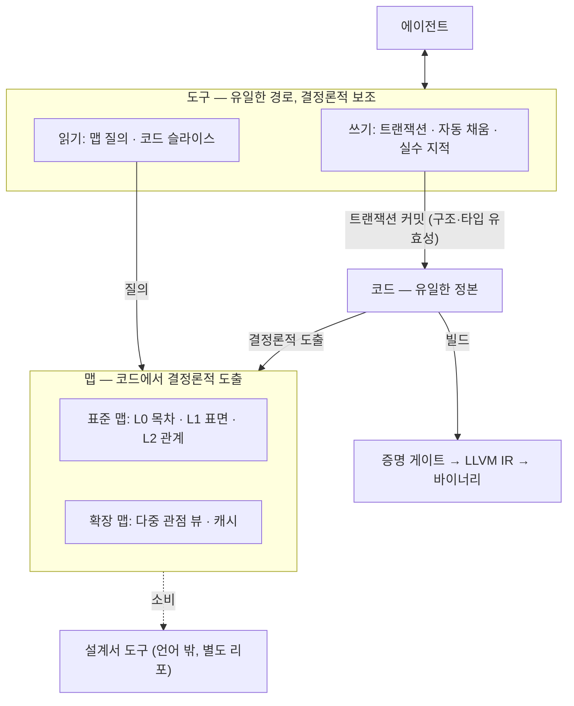

# BMB 설계 원칙

> 상태: 확정본 v1 · 2026-10-24
> 과정·결정 근거·v0 분석은 `dev-docs/v2-genesis.md`에 있다. 이 문서는 현재 확정된 설계만 담는다.

## 1. 정의

**BMB는 AI 에이전트가 쓰고, 결정론적 도구로 다루는 Rust 방언이다.**

- **표면은 Rust·Verus를 승계한다.** LLM이 학습하지 않은 언어를 기존 지식으로 유추할 수 있게 하기 위해서다.
- **의미는 더 엄격하다.** Rust·Verus가 인간 편의 때문에 남겨 둔 것까지 포기하고, 그 대가로 검증·탐색·성능을 얻는다.
- **컴파일러는 독자 구현이다.** rustc를 쓰지 않고, 파싱부터 증명 게이트, LLVM IR 생성까지 직접 수행한다.

| 기둥 | 내용 | 기반 |
| --- | --- | --- |
| 컴파일러 | 확장 문법 파싱, 타입 검사, 소유권 검사, 검증 조건 생성과 증명 게이트, 프로파일 검사, 맵 도출, LLVM IR 생성 | 자체 + Z3 + LLVM. 참고: Verus(검증 설계, 유령 코드 소거), Rust(의미론) |
| 문법 | Rust 문법 + Verus 계열 명세 문법(`requires`·`ensures`·`spec fn`·`decreases` 등) + 최소한의 확장(효과, 근거, 증명 문맥, 구성 단위) | Rust·Verus 참고, 독자 구현 |
| 도구 | 맵(L0~L2 + 확장)과 읽기·쓰기 도구. 에이전트의 유일한 접근 경로 | 자체 |

**언어의 책임 범위는 코드와 맵까지다.** 인간용 설계서와 도식은 맵을 소비하는 별도 도구가 맡는다. 이 도구도 직접 만들되 별도 리포로 두고, 마크다운 출력을 1순위로 한다.

## 2. 전제와 목표

**전제**

- **E1.** 인간은 더 이상 코드를 줄 단위로 읽고 쓰지 않는다.
- **E2.** AI 코딩의 병목은 생성이 아니라 검증(쌓이는 테스트)과 탐색(대형 코드베이스 파악)이다.
- **E3.** 쓰기 비용을 올려 검증·탐색 비용을 낮추는 거래는 이득이다.

**목표**

- **정확성은 제약이다.** 만족하지 못하면 빌드하지 않는다.
- **성능은 목적함수다.** 정확성 제약 안에서 최대화한다.
- 대형 프로젝트 확장성과 개발 속도는 위 두 목표의 결과로 따라와야 한다.
- **사용자는 에이전트다.** AI 친화성은 다른 목표와 경쟁하는 목표가 아니라 이 정의 자체다.

## 3. 원칙

1. **코드가 유일한 정본이다.** 저장은 텍스트 파일이고, 파일 배치는 도구가 결정론적으로 정한다. 저장 형식 자체는 중요하지 않다.
2. **맵은 코드에서 결정론적으로 도출되는 파생물이다.**
   - 용도별로 여러 개일 수 있다(탐색, 캐시, 비용 절감, 다른 관심사).
   - 표준 탐색 맵 L0~L2는 명세에 고정하고, 나머지는 확장 맵으로 둔다.
   - 맵은 코드의 사본이 아니라 코드로 가는 길이다. 세부가 필요하면 코드로 간다.
3. **의도는 선언으로 강제한다.** 계약은 이름 붙은 술어로 쓰고, 의도·근거 산문은 노드 해시에 묶는다. 구현에서 의도를 역추론하지 않는다.
4. **증명이 테스트를 대체한다.**
   - 증명이 없으면 바이너리도 없다.
   - 테스트가 필요한 면적은 컴파일러가 산출하고 최소화한다.
   - "테스트 0"은 지향점이다.
5. **슬라이스 예산을 빌드 제약으로 둔다.** 어떤 정의도 "본문 + 의존 계약"이 정해진 예산 안에 자급적으로 들어와야 한다.
6. **에이전트는 코드에 직접 접근하지 않는다.**
   - 경로는 도구 하나뿐이고, 도구는 맵과 코드 위에서 동작한다.
   - AI는 여전히 실수하고 컨텍스트 한계가 있다. 그 갭은 결정론적 도구가 메운다.
     - 탐색을 쉽게 한다: 맵 질의, 슬라이스.
     - 쓰기를 보조한다: 기계적으로 결정되는 표기는 도구가 채운다.
     - 실수를 지적한다: 반례, 공허 계약, 약한 명세, 변경 영향.
   - AI는 판단(의도, 설계, 명세 선택)만 맡는다. 결정론적으로 계산할 수 있는 일은 AI에게 맡기지 않는다.
   - **명시성은 산출물의 성질이고, 그 노동은 도구의 몫이다.**
7. **탐색 비용은 질의 범위에 비례한다.** 컨텍스트 한계는 파일 구조가 아니라 맵 수준과 도구 슬라이스로 다룬다. 파일은 의미를 갖지 않는다.
8. **모호성은 0으로 만든다.** 한 가지 일에는 하나의 표현과 정규형만 둔다. 진단은 구조화된 데이터다.
9. **증명이 곧 최적화 근거다.** 증명된 성질만이 런타임 검사를 지우고 최적화를 정당화한다. 검증되지 않은 계약은 최적화에 쓰지 않는다.

**비목표:** 인간의 학습 용이성, 손코딩 편의, 빠른 프로토타이핑, 텍스트 에디터 편집 경험, 설계서·도식 자체(언어 밖).

## 4. 설계 방법: 표면은 승계하고, 의미는 엄격화한다

BMB가 "더 발전된 형태"라고 말할 수 있는 근거는 하나다. Rust·Verus가 인간 편의 때문에 남겨 둔 것까지 포기하고, 그 대가를 끝까지 회수한다.

**엄격화의 형태 규칙**

- 새 구문을 만들기보다, **Rust·Verus에서 선택이던 표기를 필수로** 만든다.
- 유효한 BMB 코드는 "더 장황한 Rust"처럼 보여야 한다. 그래야 LLM의 사전 지식이 그대로 통한다.
- 새 구문은 Rust에 대응하는 형태가 없을 때만 추가한다(효과, 근거, 증명 문맥).

### 4.1 편의 포기 원장

| 영역 | Rust·Verus가 허용한 편의 | BMB | 얻는 것 |
| --- | --- | --- | --- |
| 타입 | 지역 변수 타입 추론 | 모든 타입 명시 | 슬라이스가 타입 검사기 없이 자급, 맵 L1이 정확 |
| 수명 | 수명 생략·추론 | 2차 참조(§5). 수명 표기 자체가 사라짐 | 별칭 분석 단순화, 프레임 조건 축소 |
| 호출 해석 | auto-deref, auto-ref, Deref 강제 변환, 메서드 탐색 | 금지. 호출 대상이 구문으로 확정 | 호출 그래프(L2)가 결정론적이고 정확 |
| 다형성 | blanket impl, 암묵적 trait 해석 | 겹침 없는 명시적 impl만 | 정적 호출 대상, 모듈 단위 검증 |
| 메타프로그래밍 | `macro_rules!`, proc macro | 금지 | 보이는 코드가 곧 실행 코드. 맵과 증명의 대상이 일치 |
| 이름 | 셰도잉, glob import, 재수출 | 금지. 이름 하나에 정의 하나 | 맵 L0가 정확, 질의 모호성 0 |
| 산술 | 릴리스 빌드의 조용한 오버플로 래핑, `as` 절단 변환 | 무오버플로 증명 또는 명시 연산자(래핑·포화·검사), 검사된 변환만 | 숨은 실패 경로 제거, 범위 사실이 최적화 근거 |
| 실패 | 인덱싱·`unwrap` 등 암묵적 panic, `?`의 암묵적 `From` 변환 | panic 없는 전함수가 기본, 오류는 타입으로 명시 | 테스트가 겨냥하던 예외 경로가 사라짐 |
| 종료 | 종료성 증명은 선택 | `decreases` 필수 | 전함수 보장 |
| 효과 | 어떤 함수든 IO·할당·시간·난수 사용 가능 | 효과 선언과 검사(IO, 할당, panic, 비결정) | 테스트 필요 면적 산출, 순수 구간은 증명만으로 충분 |
| 증명 자동화 | 트리거 자동 선택, spec 함수 자동 전개, 전역 문맥 | 트리거 명시, 정의는 기본 불투명, 증명마다 사용할 사실 선언 | **증명 안정성**(SMT 취약성의 주원인인 무관한 문맥 제거), 의존 해시 기반 증명 캐시 |
| 탈출구 | `assume`, `external_body`, `unsafe` 블록 | 근거 선언 필수, 맵에 미증명 면적으로 집계 | 신뢰 기반의 크기가 측정됨 |
| 표현 | 같은 일을 여러 방식으로(반복자·루프, `match`·`if let`) | 정규형 하나 | 모호성 0, 동형 함수 탐지 |
| 주석 | 자유 텍스트 | 노드 해시에 묶인 구조화 근거 | 의도가 맵의 일부가 되고, 어긋나면 감지됨 |
| 구성 단위 | 파일 = 모듈 | 선언된 단위, 파일은 투영 | 원칙 7 |

**긴장과 대응.** 의미를 엄격화할수록 LLM은 Rust 습관대로 쓰다가 거부당한다. 타입을 생략하거나 `vec!`·`println!` 같은 매크로를 쓰는 경우다. 대응은 셋이다.

1. 컴파일러가 "Rust 습관 → BMB 형태"를 구조화된 수정 제안으로 돌려준다. 기계적으로 바꿀 수 있는 것은 도구가 자동으로 고친다(원칙 6).
2. **Rust 습관 오류율**을 측정 축에 넣어, 엄격화 하나하나가 유추 가능성을 얼마나 깎는지 숫자로 본다.
3. 회수하는 대가보다 유추 손실이 큰 항목은 되돌린다.

### 4.2 비규범 예시

문법은 확정 전이다. 아래는 "더 장황한 Rust"라는 방향을 보여 주기 위한 예시일 뿐이다.

```rust
#[effects(pure)]
fn index_of(arr: &[i64], target: i64) -> (result: Option<usize>)
    requires is_sorted(arr),
    ensures  found_at(arr, target, result),
{
    let mut lo: usize = 0;
    let mut hi: usize = arr.len();
    while lo < hi
        invariant lo <= hi, hi <= arr.len(), not_in_outside(arr, target, lo, hi),
        decreases hi - lo,
    {
        let mid: usize = lo + (hi - lo) / 2;
        // ...
    }
    Option::None
}
```

## 5. 메모리 모델

- **소유·이동 + 2차 참조**를 쓴다. 참조(`&`, `&mut`)는 함수 인자로만 넘길 수 있고, 저장하거나 반환할 수 없다.
- 그 결과 수명 표기와 수명 추론이 언어에서 사라진다. 표면은 Rust의 `&`·`&mut` 그대로다.
- 별칭이 제한되므로 검증기의 프레임 조건이 단순해지고, 모든 `&mut`에 noalias를 붙일 수 있다.
- **비용:** 참조를 담는 구조(반복자, 뷰 등)는 핸들이나 인덱스 방식으로 대체해야 한다.

## 6. 아키텍처



- **읽기**는 맵 질의에서 시작해, 필요한 만큼만 코드 슬라이스로 내려간다.
- **쓰기**는 트랜잭션 단위로 코드에 커밋된다.
  - 커밋 시점에 구조와 타입의 유효성은 필수다.
  - 증명은 빌드 게이트에서 강제한다. 편집 중에는 미완성 증명을 허용하되, 그 상태를 맵에 표시한다.
- **맵**은 정의 단위 해시를 키로 증분 재도출된다. 모든 맵은 본질적으로 코드 해시를 키로 하는 캐시다.
- **증명 게이트**는 unknown, timeout, 솔버 부재를 모두 실패로 처리한다.
- **확장 맵 생성기**는 BMB 순수 함수로 작성한다. 결정론은 규약이 아니라 언어가 증명하는 성질이다.

## 7. 맵

### 7.1 표준 탐색 맵 (명세에 고정)

| 수준 | 내용 | 답하는 질문 |
| --- | --- | --- |
| L0 목차 | 구성 단위 계층, 이름, 한 줄 요약 | 전체가 어떤 단위로 이루어져 있나 |
| L1 표면 | 공개 시그니처, 계약 이름, 효과 | 이것을 쓰려면 무엇을 알아야 하나 |
| L2 관계 | 해석이 끝난 호출·의존·데이터 흐름 엣지 | 이것을 바꾸면 어디가 영향받나 |

- 코드는 맵에 들어가지 않는다. 맵은 위치와 해시로 가리키기만 하고, 필요할 때 도구가 꺼내 준다.
- 이후 수준 추가는 하위 호환으로만 허용한다.

### 7.2 다중 관점 뷰

표어는 **"추적하지 말고 조회한다"**다. 모든 해석은 빌드 시점에 한 번 계산되어 평탄화된다. 에이전트는 상속 체인을 따라가거나 파일을 하나씩 열지 않는다.

| 뷰 | 답하는 질문 |
| --- | --- |
| 구성 (L0) | 전체가 어떤 단위로 이루어져 있나 |
| 표면 (L1) | 이것을 쓰려면 무엇을 알아야 하나 |
| 호출 (L2) | 누가 부르고 무엇을 부르나(해석이 끝난 대상, 정·역방향, 전이) |
| 타입 능력 | 이 타입이 할 수 있는 모든 것(모든 impl을 출처와 함께 평탄화) |
| 계약 | 이 술어를 보장하는 곳과 요구하는 곳 |
| 효과 | IO·할당·비결정에 닿는 모든 경로 |
| 변이·데이터 흐름 | 이 필드를 쓰는 곳, `&mut`이 흘러가는 경로 |
| 증명 의존 | 이 보조정리·계약에 기대는 증명들 |
| 미증명 면적 | 탈출구와 그 근거, 테스트가 필요한 경계 |
| 중복·동형 | 같거나 거의 같은 정의의 묶음 |
| 변경 영향 | 이것을 바꾸면 무엇을 다시 검증해야 하나 |

모든 뷰는 같은 그래프의 투영이다. 이 뷰들이 정확할 수 있는 이유는 언어가 해석을 모호하게 만드는 요소(auto-deref, blanket impl, 매크로, glob import)를 미리 없앴기 때문이다(§4.1).

## 8. 대가 회수 카탈로그

### 8.1 컴파일러 레벨 (결정론적으로 자동 적용)

| 회수 | 내용 | 가능하게 하는 포기 |
| --- | --- | --- |
| 동등 규약 병합 | 계약·술어를 정규형으로 만들어 해시한다. 동등한 것은 하나의 이름 붙은 술어로 합치고, 증명도 한 번만 한다 | 정규형 하나 |
| 동형 함수 병합 | 알파 동치인 정의를 바이너리에서 하나로 합친다 | 정규형, 매크로 금지 |
| 계약 방화벽 증분 빌드 | 본문이 바뀌어도 계약이 그대로면 호출자를 다시 검증·컴파일하지 않는다. 정의 해시와 의존 계약 해시로 캐시한다 | 모듈 단위 검증, 증명 문맥 선언 |
| 검사 제거 | 증명된 범위·비널·비영 사실로 런타임 검사를 지우고, 그 사실을 LLVM에 전달한다(검증된 것만) | 암묵적 panic·오버플로 금지 |
| 별칭 부재 보장 | 모든 `&mut`에 noalias를 붙인다. Rust보다 강한 별칭 사실로 벡터화·재배치를 돕는다 | 2차 참조 |
| 효과 기반 최적화 | 순수 구간의 공통 부분식 제거, 메모화, 병렬화, 컴파일 타임 평가 | 효과 선언 |
| 닫힌 세계 최적화 | 호출 대상이 정적으로 확정되므로 가상 호출과 죽은 코드를 정확히 제거한다 | 암묵적 해석·blanket impl 금지 |

### 8.2 도구 레벨 (결정론적 제안, 채택은 AI가)

| 제안 | 내용 |
| --- | --- |
| 해체·분할 | 슬라이스 예산을 넘는 정의에 분할 지점을 제안하고, 그 지점의 중간 단언으로 추출 함수의 계약 초안을 만든다 |
| 재조립·일반화 | 상수나 타입만 다른 유사 정의를 찾아 제네릭으로 묶는 안을 낸다 |
| 재사용 검색 | 필요한 술어를 함의하는 post를 가진 정의를 찾는다. 새로 쓰기 전에 제안한다 |
| 계약 조정 | 증명에 쓰이지 않는 pre(약화 가능), 어느 호출자도 쓰지 않는 post, 구현을 변형해도 통과하는 약한 명세를 지적한다 |
| 기계적 표기 자동 채움 | 명시 타입, import, 정규형 변환, `decreases`·트리거·프레임 조건 후보, Rust 습관 교정 |
| 보존형 리팩터링 | 이름 변경·이동·분할·합치기를 증명을 깨지 않는 트랜잭션 연산으로 제공한다 |
| 사전 영향 분석 | 커밋 전에 깨질 증명, 호출자, 효과 변화를 보여 준다 |
| 실수 지적 | SMT 반례를 구체적인 입력값으로, 공허 계약, 동형·중복 정의 |

**도구 체인의 결정론 규칙**
- 도구 체인 안에는 LLM 같은 비결정 판단을 넣지 않는다. 같은 입력이면 같은 제안이 나와야 한다.
- SMT를 쓰는 제안은 시간 제한이 아니라 고정 자원 한도(Z3 `rlimit`)로 실행한다.

## 9. 열린 연구 주제

- **R2. 에이전트 출력 형태:** 텍스트 코드 조각과 구조화 편집 연산(JSON 등) 중 어느 쪽의 성공률이 높은가.
- **R3. 인간 패러다임 너머:** OOP 등을 전제하지 않는 구조. 동형 함수 병합, 의미 기반 분할, 전체 프로그램 최적화를 다룬다.
- **R4. 측정 축:** 처음부터 측정 대상으로 둔다.
  - 대형 코드베이스 탐색·수정 정확도
  - 질의당 토큰 비용과 슬라이스 크기
  - 1회 성공률(재시도 없음, 문제·프롬프트 고정)
  - Rust 습관 오류율
  - 테스트 필요 면적과 미증명 면적의 추이
