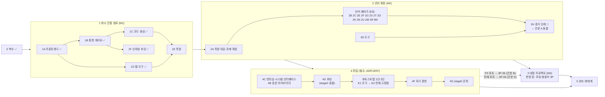
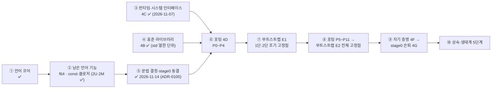
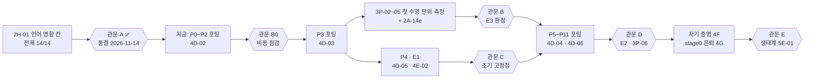
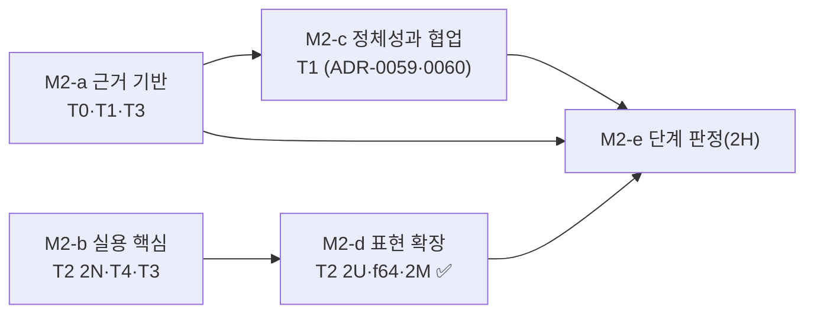

# BMB 로드맵

> 갱신: 2026-11-14(**동결 선언**: 사람 승인 "1/2 승인", ADR-0100·0137·0138·0139 채택, 관문 A 통과, 버전 `0.1.0`) · 2026-11-14(진행 리뷰 `dev-docs/reports/progress.md`, 사람 지시 "전체 로드맵에서 진행상황 리뷰, 태스크 도출-로드맵 업데이트": 지금 위치와 우선순위 재정렬, 관문 A 전제 분할 ADR-0137 제안) · 2026-11-11(승인 "A1~A7 권장안 채택": ADR-0105 채택, 목표값 확정 ADR-0115, 관문 B0·동결 전 stage0 축소 조사 ADR-0116, 3P-08 승인) · 2026-11-11(승인 "모두 승인, 권장안 채택": ADR-0111·0112·0113 채택, 1E 통과 기준 3 취소, 5A-01을 4D-02의 선행으로) · 2026-11-11(종합 검토 `dev-docs/reviews/roadmap-2026-11-11.md`, 사람 지시 "전체 로드맵을 검토하고 수립": 상태 정정, 임계 경로와 판정 관문·가설 등급·품질 관리 체계 절, 우선순위 절의 지난 범위는 백로그로) · 2026-11-05(언어 전체 수순 절 신설·우선순위 재정렬·상태 갱신, 사람 지시 "언어가 갖춰야 할 전체 수순은 로드맵에") · 2026-11-01(승인 반영: 백로그 실행 계획 2026-11-01) · 2026-10-31(우선순위 재정렬: 세션 기록·병렬 세션) · 2026-10-30(정식 측정 경로 ADR-0066, 우선순위 재정렬) · 2026-10-28(트랙·국면 M2-a~M2-e·우선순위·가설 등록부, ADR-0058) · 2026-10-25(실행 순서 웨이브) · 2026-10-24(페이즈 재구성) · 태스크 단위 진행은 `dev-docs/BACKLOG.md`에 있다.
> 설계는 `docs/DESIGN.md`, 결정 근거는 `dev-docs/adr/`.

## 운영 원칙

- **단계는 통과 기준으로 닫는다.** 기준은 측정할 수 있어야 하고, 측정 결과를 커밋해야 닫힌다. "약 95%" 같은 추정으로 닫지 않는다(genesis §3.5).
- **다음 단계는 앞 단계의 측정이 정한다.** 2단계 이후의 범위는 후보 목록이다. 1단계 측정 결과로 우선순위를 다시 정하고 ADR로 남긴다.
- **차별점 가설을 먼저 잰다.** 그 위에 기능을 쌓는 것은 측정 뒤다.
- **생태계는 마지막이다.** 원칙 4(증명이 테스트를 대체)와 원칙 6(도구 경유 접근)이 측정으로 입증되기 전에는 열지 않는다.
- **로드맵은 언어가 갖춰야 할 전체 수순을 담는다(사람 지시 2026-11-05).** 언어 기능, 런타임·시스템 인터페이스, 표준 라이브러리, 문법 결정, 포팅, 부트스트랩 1단·2단, 자기 증명, stage0 은퇴, 성숙·생태계까지 한 줄로 이어진 순서(아래 "언어 전체 수순")를 두고, 당장의 작업 범위는 그 위치를 밝혀 "우선순위"에 적는다. 측정·가설 작업이 길어져도 이 수순은 지운 채로 두지 않는다. 태스크 단위 진행은 백로그에 있다.
- **큰 투자 앞에는 판정 관문을 둔다(ADR-0111).** 관문마다 결과별 조치를 측정 전에 등록한다. 한 전제의 판정을 다음 측정으로 옮기는 것은 한 번이다(아래 "임계 경로와 판정 관문").
- **측정 머신은 존재 가설에 먼저 쓴다(ADR-0111).** 가설은 반증될 때 다시 쓰는 것(전제·원칙, 원장·ADR, 도구 기본값)에 따라 세 등급이다(아래 "가설 등급").

## 한눈에 보기

4단계는 3단계를 기다리지 않는다. 3단계의 판정은 4단계의 포팅이 만드는 쌍둥이(stage0 Rust와 그 BMB 포트) 위에서 한다(ADR-0104, 범위는 ADR-0105). 4D 착수는 stage0 동결(4D-01, 2H-02 뒤)이 정한다.

| 단계 | 목적 | 상태(2026-11-11) |
| --- | --- | --- |
| 0 착수 | v0 정리, 설계·결정 문서 | 완료 |
| 1 최소 관통 경로 | "에이전트가 파일 없이, 테스트 없이, 증명된 코드를 쓴다"를 수십 개 정의 규모에서 측정 | 1A~1F 완료. 1E 측정은 정식 경로로 끝났고(T0-10 qwen, T0-11 sonnet, T0-12 반복 5회) 보고서와 마찰 기록을 확정했다(`dev-docs/measurements/m1.md`, 1E-06·1E-11, 2026-11-11). 1E-07과 통과 기준 3은 취소(승인 2026-11-11). 종료 정리 2H-09 완료 |
| 2 언어 확장 | 1단계 측정이 가리킨 병목을 푼다. 실용 프로그램을 쓸 수 있는 언어 | 언어 페이즈 모두 완료(2B 기준 4는 취소, 2F-04 보류, `f64` T2-03은 2026-11-08, 문법 결정 2R은 ADR-0095와 2R-05로 2026-11-10). 국면은 M2-c(`dev-docs/health/M2c.md`, 2026-11-11)와 M2-d가 닫혔다(M2-a 감사 2P-01은 2A-14e 대기, M2-b 감사 2P-02는 공식 Benchmarks Game 비교 T3-01이 막힘). M2-e(2H) 진행: 증거 단계 2H-01에서 2R-05·T0-21·T0-18·3A-06 끝, T0-08(sonnet 변별 실패, qwen 반복 중)·T1-41(qwen 남음)·2A-14e 진행 중 |
| 3 대형 프로젝트 | 수천 개 정의 규모에서 탐색·증명 비용이 질의 범위에 비례하고, 여러 에이전트의 편집이 정의 단위로 합쳐짐을 보인다. 큰 코드의 이해·리팩터링·과업 달성(ADR-0104) | 준비: 쌍둥이 하네스 3P-01·문서 조건 3P-07 완료, BNB 모델 실행 3A-06 완료(G4는 sonnet 충족, H-SCALE 반증·경계). 범위는 ADR-0105(채택 2026-11-11). 첫 판정은 관문 B(3P-05) |
| 4 자립 | 런타임·시스템 인터페이스와 표준 라이브러리, 포팅, 부트스트랩 1단(stage1)·2단(stage2 = stage3 고정점), 자기 증명, stage0 은퇴(ADR-0037, 필수) | 4A 완료(자립 사다리 L0·L1 ✅, S5 = 1/42), 4C 완료(2026-11-07, ADR-0091), 4B 완료(2026-11-08, ADR-0092, `std` 열한 단위 전부 증명). 4D는 동결 선언(4D-01, 관문 A) 대기(2026-11-14: 전제 13/14, 14/14) → **동결 선언 2026-11-14, 자립 사다리 L2**. 4D-02 진행. BMB로 쓴 컴파일러는 0줄(S6) |
| 5 언어 성숙·생태계 | 명세·적합성 시험, 안정성 정책, 재현 가능한 빌드·배포, 생태계 | 5A 일부 진행 가능 |

페이즈별 태스크 상태는 백로그에서 만든다(`python3 scripts/progress.py --write-roadmap`, 게이트가 신선도를 확인). 위 표와 절 제목의 "완료"는 통과 기준과 감사의 판정이고, 아래 표는 태스크의 수다.

<!-- roadmap:status begin (scripts/progress.py --write-roadmap; do not edit by hand) -->

| 단계 | 페이즈 | ✅/전체 | 🔄 진행 | ⏳ 대기 | 🚫 막힘 |
| --- | --- | --- | --- | --- | --- |
| 0 착수·인프라 | 0 | 3/5 | — | — | `0-04`, `0-05` |
| 0 착수·인프라 | INF | 39/39 | — | — | — |
| 1 최소 관통 경로 | 1A | 15/15 | — | — | — |
| 1 최소 관통 경로 | 1B | 59/59 | — | — | — |
| 1 최소 관통 경로 | 1C | 7/7 | — | — | — |
| 1 최소 관통 경로 | 1D | 24/24 | — | — | — |
| 1 최소 관통 경로 | 1E | 12/12 | — | — | — |
| 2 언어 확장 | 2A | 17/24 | `2A-14`, `2A-14e` | `2A-07`, `2A-13a`, `2A-13b`, `2A-14f` | `2A-15` |
| 2 언어 확장 | 2B | 22/22 | — | — | — |
| 2 언어 확장 | 2C | 6/6 | — | — | — |
| 2 언어 확장 | 2D | 31/39 | `2D-30` | `2D-12`, `2D-13`, `2D-26`, `2D-27`, `2D-36`, `2D-37`, `2D-39` | — |
| 2 언어 확장 | 2E | 5/5 | — | — | — |
| 2 언어 확장 | 2F | 4/5 | — | `2F-04` | — |
| 2 언어 확장 | 2G | 7/7 | — | — | — |
| 2 언어 확장 | 2S | 3/3 | — | — | — |
| 2 언어 확장 | 2V | 36/36 | — | — | — |
| 2 언어 확장 | 2T | 15/15 | — | — | — |
| 2 언어 확장 | 2O | 11/11 | — | — | — |
| 2 언어 확장 | 2K | 11/11 | — | — | — |
| 2 언어 확장 | 2U | 7/7 | — | — | — |
| 2 언어 확장 | 2N | 18/19 | — | `2N-14` | — |
| 2 언어 확장 | 2M | 3/3 | — | — | — |
| 2 언어 확장 | 2R | 19/19 | — | — | — |
| 2 언어 확장 | 2H | 7/8 | `2H-01` | — | — |
| 2 언어 확장 | 2P | 4/6 | — | `2P-01`, `2P-02` | — |
| 트랙 | T0 | 32/39 | `T0-08`, `T0-33` | `T0-15`, `T0-17`, `T0-37`, `T0-41` | `T0-38` |
| 트랙 | T1 | 45/58 | `T1-04`, `T1-41` | `T1-03`, `T1-07`, `T1-13`, `T1-21`, `T1-22`, `T1-23a`, `T1-24a`, `T1-44b`, `T1-44i`, `T1-47` | `T1-44f` |
| 트랙 | T2 | 17/19 | — | `T2-15`, `T2-19` | — |
| 트랙 | T3 | 1/5 | — | `T3-02`, `T3-05` | `T3-01`, `T3-04` |
| 트랙 | T4 | 5/5 | — | — | — |
| 3 대형 프로젝트 | 3A | 6/6 | — | — | — |
| 3 대형 프로젝트 | 3P | 4/9 | — | `3P-02`, `3P-03`, `3P-04`, `3P-05`, `3P-06` | — |
| 4 자립 | 4A | 4/4 | — | — | — |
| 4 자립 | 4B | 4/4 | — | — | — |
| 4 자립 | 4C | 5/5 | — | — | — |
| 4 자립 | 4D | 14/21 | `4D-02` | `4D-03`, `4D-04`, `4D-05`, `4D-06`, `4D-12`, `4D-20` | — |
| 4 자립 | 4E | 0/2 | — | `4E-01`, `4E-02` | — |
| 4 자립 | 4F | 0/1 | — | `4F-01` | — |
| 4 자립 | 4G | 0/1 | — | `4G-01` | — |
| 5 성숙·생태계 | 5A | 5/5 | — | — | — |
| 5 성숙·생태계 | 5B | 1/2 | — | `5B-02` | — |
| 5 성숙·생태계 | 5C | 0/4 | — | `5C-01`, `5C-02`, `5C-03`, `5C-04` | — |
| 5 성숙·생태계 | 5D | 1/4 | — | `5D-01`, `5D-02`, `5D-04` | — |
| 5 성숙·생태계 | 5E | 0/1 | — | `5E-01` | — |

<!-- roadmap:status end -->

## 언어 전체 수순 (2026-11-05)

BMB가 "에이전트가 쓰는 증명된 시스템 언어"로 서려면 아래 열 층을 모두 지나야 한다. 앞 층이 끝나야 뒤 층이 닫히지만, 착수는 겹친다(ADR 초안·설계는 언제나 앞당긴다). 근거는 셀프호스팅 격차 분석(`dev-docs/measurements/selfhost-gap.md`, 4A-01)과 포팅 지도(`selfhost-port-map.md`, 4A-02), 부트스트랩 정의는 ADR-0037.

| 층 | 내용 | 지금(행마다 적힌 날짜 기준, 요약은 위 표) | 남은 일과 순서 | 정의·통과 기준 |
| --- | --- | --- | --- | --- |
| ① 언어 코어 | 정수·`bool`·함수·계약·루프(1A~1C), 데이터 타입(2B), 변환(2C), 탈출구(2E), 효과(2F), `Vec`·이동(2G), 바이트(2S), 제네릭·trait(2T), 소유 타입·`Box`·재귀(2O), 조기 탈출·`for`·`?`(2K), 정수 폭·비트 연산(2N), `proof fn`(T1-18), 타입 불변식(T1-11) | 완료(2E·2F 종료 감사 2026-11-06) | 2F-04(ADR-0084로 보류) | 각 페이즈 절 |
| ② 남은 언어 기능 | 문자열 `String`·`&str`·`char`(2U, ADR-0050), 메서드 구문의 수신자 조정(2M, ADR-0051), `f64` 마무리(T2-03), 상수 항목·클로저(ADR-0052·0053, 2V-18 승인 대기), 복합 대입(2N-07)·명세 정수 갈래(2N-08) | 2U 완료(2026-11-05, 감사 `dev-docs/health/2U.md`), 2M 완료(2026-11-07, 감사 `dev-docs/health/2M.md`: 해석·수신자 조정·정규형·이주·퍼저), 후속 2T-09(이동 타입의 trait `Self`) | 2M → T2-03 남은 것. 2U 후속: UTF-8 불변식 사실(2U-06), 문자열 표준 연산(2U-07, ④). 셀프호스팅에 대체 불가인 것은 문자열(렉서부터)과 상수 표(진단 코드표, ADR-0052 또는 `match` 함수) | ADR-0050~0053, 2U·2M 절 |
| ③ 런타임·시스템 인터페이스 | 생성 바이너리가 링크하는 실행 환경: 입력(표준 입력·파일 읽기), 파일·디렉터리 쓰기·이름 바꾸기·삭제, 대화형 파이프가 있는 프로세스(Z3·clang), 인자·환경 변수·종료 코드, 단조 시계, 스택 크기(재귀 중첩 256), `io` 오류 문구, `io`·`nondet` 효과와 `external_body` 신뢰 경계 | 4C-02 대부분(2026-11-06): 인자·종료 코드·표준 오류·표준 입력, 파일·디렉터리·원자적 바꾸기, 환경·단조 시계, 파이프 프로세스 `std::process::run`, 재귀 프로그램의 256MiB 스택, `io::Error`(Rust와 같은 문구), 효과 `nondet`. libc 위 IR 런타임 `codegen/sys.rs`, 부르는 것만 링크. 대화형 프로세스 `spawn`·`Child`(2026-11-07: 고정된 Z3와 질의마다 대화). 종료 감사 `dev-docs/health/4C.md`(2026-11-07): stage0 외부 호출 열여섯 모두 대체(4C-06: 링크 질의, 새 파일로만 쓰기, 자식 표준 오류 버리기, 닫힌 표준 출력의 141). ③ 닫힘 | 4C-03 ADR 초안 ✅ → 4C-01 채택 ✅(2026-11-06, ADR-0091: 닫힌 내장 목록, libc 위 IR 런타임, FFI 없음) → 4C-02 구현(조각 (a)~(f), stage0의 외부 호출 전부를 예제로 대체) | 4C, 격차 분석 §3.4·§5.3 |
| ④ 표준 라이브러리 | 바이트 버퍼·문자열 연산, 정수 서식·해석(10진·16진), 정렬된 맵·집합, 안정 정렬, JSON 읽기·쓰기, 인턴 표, 서식 출력. 모두 계약과 증명 | `lib/` 증명된 라이브러리 다섯(`bytes`·`sha256`·`utf8`·`base64`·`crc32`, T4-01~04) | 4B-03 ADR 초안 ✅ → 4B-01 채택 ✅(2026-11-06, ADR-0092: BMB로 쓰고 증명한 `std` 단위, 정렬된 `Vec` 위의 `BTreeMap`) → 4B-02 구현 ✅(2026-11-08: `std::str`·`num`·`slice`·`collections`(텍스트 키, 4B-04)·`intern`·`json`(T4-05 합침)과 옮긴 다섯, 종료 감사 `dev-docs/health/4B.md`) | 4B, 격차 분석 §5.1 |
| ⑤ 문법 결정·stage0 동결 ✅ | 포팅 전에 표면을 확정(ADR-0037 §6), stage0 기능 동결(4D-01 ✅ 2026-11-14, 동결 뒤 언어 변경 감지 CI). 2단계 판정(2H)의 남은 칸은 관문 B로(ADR-0137) | 2R-01~2R-04 완료, 2R-06 채택(ADR-0095, 2026-11-08; A1은 ADR-0096 r2)과 구현(2R-07~2R-11, 2N-07, 2N-12, 감사 `dev-docs/health/2R.md`: 조건부 통과), 2R-05 완료(qwen 3회: 작성 성공률 0.813 → 0.920, 구간이 겹쳐 실행 간 변동 안, 거부된 커밋 60 → 26, `dev-docs/measurements/2r05.md`), 2H-01 증거 단계 진행 중. 동결 전 표면 결정 ADR-0097·0098·0099·0052·0053은 채택·구현(2026-11-09), 동결 ADR-0100은 승인됐고 선언은 2H-01·2H-02 뒤. 동결 전 표면 결함 2V-20j·2V-20k(ADR-0114)·2D-31은 고침, 정의 요약 3P-08(ADR-0117) 구현(2026-11-11) | 2H-01 마감 → 2H-02 → 4D-01(관문 A). 함께: 5A-01 레퍼런스 초안, 4D-07 포팅 지도 재기준 | 2R·2H 절, 4D |
| ⑥ 포팅 P0~P4 | 기반 라이브러리·런타임(P0), 렉서(P1), 파서(P2), 검사기·정규형(P3), 코드 생성(P4, 전체 검사 모드: 증명기 없이) | 차등 시험 수단 완료(4A-03: `bmb dump tokens`·`dump parse`, 퍼저 내보내기), 통합 시험 CLI 이전 완료(4A-04, S5 = 1: 인코더 항의 단위 시험 `lemmas.rs`만) | 4D-02 → 4D-03 → 4D-05 | 포팅 지도 §3: 구성 요소마다 stage0과 같은 바이트 |
| ⑦ 부트스트랩 E1(조기 고정점) | **1단:** stage0이 BMB 컴파일러 소스(C0~C4·C8, 약 42%)를 빌드한 stage1이 P1~P4 차등 시험을 통과. **2단:** stage1로 같은 소스를 빌드한 stage2와 stage2로 빌드한 stage3의 IR이 같다 | — | 4E-02 | 포팅 지도 E1 |
| ⑧ 포팅 P5~P11, 부트스트랩 E2(전체 고정점) | 증명 인코딩·해법기 연결(P6·P7), 맵(P5), 캐시·증분(P8), 도구(P9), 작업 공간(P10), MCP·CLI(P11). 그 뒤 전체 컴파일러로 1단·2단을 다시: stage2 = stage3 바이트 동일, stage2가 전체 게이트 통과, CI 매 커밋 | — | 4D-04 → 4D-06 → 4E-01 | ADR-0037, 포팅 지도 E2. 자립 사다리 L3 |
| ⑨ 자기 증명·stage0 은퇴 | BMB 컴파일러가 자기 증명 게이트를 통과(미증명 면적 상한, 포팅 지도는 5% 제안, 런타임 경계 `external_body` 15~25), Rust 컴파일러를 씨앗으로 동결·보존 | — | 4F-01 → 4G-01(승인) | 자립 사다리 L4 |
| ⑩ 성숙·생태계 | 명세·적합성 시험(5A), 안정성 정책(5B), 재현 가능한 빌드·다중 타깃·DWARF(5C), 도구 완성(5D), 패키지·바인딩(5E, 원칙 4·6 입증 뒤) | 5A 일부 | 5단계 절 | 5단계 절 |

### 임계 경로와 판정 관문 (2026-11-11)

**지금 위치(2026-11-14):** ①~④가 닫혔고 ⑤의 문법 결정은 채택·구현됐다(ADR-0095, 2R-05). 관문 A의 전제 14개 중 13개가 닫혔다(`dev-docs/health/freeze-readiness.md`: 3단계 범위 ADR-0105, 동결 전 표면 결함, 정의 요약 3P-08, stage0 축소 조사 4D-11, 레퍼런스 초안 5A-01, 포팅 지도 재기준 4D-07, 포팅 원장 4D-08, `bool` 순서 비교 5A-04, `push` 길이 4D-13, 적합성 시험이 찾은 결함 2V-21~23). 남은 하나는 증거 단계 2H-01의 세 칸이고 측정 머신에 있다: T0-08 qwen 반복, T1-41 qwen, 2A-14e. 측정 결과는 2026-11-10 뒤로 커밋되지 않아 임계 경로는 2026-11-11 뒤로 움직이지 않았다. 세 칸의 등록된 조치에는 받아들이는 언어의 변경이 없으므로, 관문 A가 기다리는 것을 언어 영향 칸으로 좁히고 세 칸을 관문 B로 옮겼다(ADR-0137, 사람 승인 2026-11-14). 그래서 전제 14개가 모두 닫혔고, 같은 날 동결을 선언했다(4D-01, 사람 승인: ADR-0100 채택, `surface.json`의 `frozen: true`, 컴파일러 버전 `0.1.0`은 ADR-0138). **관문 A를 지났다. 지금은 ⑥의 첫 조각 4D-02(P0~P2 포팅)다.** 받아들이는 언어의 변경은 이제 사유 있는 예외뿐이다. 측정(T0·T1 트랙)은 측정 머신에서 직렬로 돌고 코드 작업을 막지 않는다.

**기다리는 동안의 규칙(2026-11-14).** stage0은 2026-11-11의 62,668줄에서 65,664줄로 늘었다(`scripts/components.py table`). 늘어난 줄은 배율(포팅 지도 §7.3의 3.5~5.7)만큼 포팅할 양이 된다. 그래서 동결 선언 전이라도 이 환경의 작업은 stage0을 늘리지 않는 것(포팅 준비, 결정 초안, 계측)을 먼저 하고, 도구(C10~C12)와 증명 인코딩(C6)의 기능 작업은 그 구성 요소의 포팅 전으로 순서를 내린다(고정 전에 끝내면 된다, ADR-0113).

관문은 ADR-0111이 정한다(채택 2026-11-11). 두 팔의 비교는 차이의 구간으로 판정한다(ADR-0112). 관문 B와 C는 서로 순서가 없고, 둘 다 지나야 P5 이후를 연다.

| 관문 | 위치 | 지나려면 커밋돼 있어야 하는 것 | 결과별 조치(측정 전 등록) |
| --- | --- | --- | --- |
| A 동결 | ⑤ 끝 | 2H-01 결과와 등록부·효용 보고서 갱신, 2H-02(ADR-0105 ✅ 채택 2026-11-11), 2V-20j·2V-20k·2D-31(✅ 2026-11-11), 3P-08(✅ 2026-11-11, ADR-0117), stage0 축소 조사 4D-11(ADR-0116), ADR-0100 `frozen: true`. ADR-0111이 더한 것: 동결 커밋의 언어 레퍼런스 초안(5A-01), 포팅 지도 재기준(4D-07), 포팅 원장의 계측(4D-08), DESIGN §4.2의 "문법은 확정 전" 문장 정리 | 2H-01 결과가 언어 변경을 요구하면 동결 전에 고친다(ADR-0103). ADR-0105 결정 4의 조건(BNB·H-EDIT)은 등록된 대로. ADR-0137(채택 2026-11-14): 이 관문의 전제는 2H-01 가운데 등록된 조치에 언어 변경이 있는 칸이고 모두 끝났다. 남은 세 칸은 관문 B로 |
| B0 비용 점검(ADR-0116) | P2(렉서·파서, 약 5.9천 줄·9%: 현재 값은 포팅 원장 `port-ledger.md`; 그 차등 시험이 `fmt`를 요구해 함께 옮기는 양은 약 7.8천 줄, 포팅 지도 §3.3) 차등 시험 통과 뒤, P3 착수 전 | 포팅 원장 C0~C2 행(계약 없는 배율과 증명한 배율, 작성 비용, 증명된 정의 비율, 탈출구, 마찰), 그 실측으로 다시 낸 전체 추정과 포팅 지도 §7 갱신(4D-12) | 보고 관문이다. 추정이 §7의 범위(21만~34만 줄) 안이면 계획대로. 범위를 넘거나, C2의 증명된 정의 비율이 절반 미만이거나, 미결정 의무가 작성 비용의 과반이면 P3 전에 보고하고 승인 뒤 진행 |
| B 경제성 | P3 차등 시험 통과 뒤, P5 착수 전 | 3P-05(H-TASK·G5-L·H-COMPREHEND·H-REFACTOR, qwen 반복·sonnet 1회), 2A-14e(H-AMORT), 포팅 원장 P0~P3, 2H-01의 남은 칸 T0-08 qwen 반복·T1-41 qwen(ADR-0137) | E3 기준은 ADR-0102 결정 2. **성립:** 계획대로. **반증:** P5 이후 착수를 멈추고(P4·E1은 끝낸다) 실패 귀속과 방향 ADR을 승인 안건으로(귀속 층 수리 뒤 한 번 재측정 / 전제·목표 개정 / 효용 주장을 입증된 축으로 한정). **판정 불가:** 관문 D로 한 번 이월 |
| C 조기 고정점 | ⑦ | stage1이 P1~P4 차등 시험 통과, stage2 IR = stage3 IR, stage1 대 stage0의 컴파일 시간·바이너리 크기(G6·G9의 첫 실규모 값), 포팅 코드의 증명된 정의 비율(S7, 4D-08) | 고정점 실패는 컴파일러 층 결함으로 고친다. 실규모 성능이 G6(±5%) 밖이면 원인 조사 태스크를 내고 P5와 병행한다(멈추지 않음) |
| D 전체 고정점 | ⑧ 끝 | stage2 = stage3 바이트 동일, stage2가 전체 게이트 통과, 3P-06(크기 축 H-SCALE·H-SLICE), 이월된 E3 재판정 | 3단계 통과 기준(3E)의 판정. 이월된 판정이 다시 성립하지 않으면 "보이지 못함"으로 기록하고 DESIGN·README·효용 보고서의 서술을 고친다(이월은 한 번) |
| E 생태계 | ⑨ 뒤 | 관문 B·D의 판정, 4F 미증명 면적, 4G 씨앗 재현 | 원칙 4·6이 입증됐을 때만 5E를 연다(운영 원칙). 아니면 5A~5D까지 |

이미 한 번 옮겨진 판정: G5 과제 단위 미충족 → G5-L(ADR-0102), H-EFFECT 반증 → 실제 코드의 효과 분포, H-SCALE 반증(경계) → 포팅 쌍둥이. 셋 모두 관문 B·D가 받는다.

### 진행 규칙(단계·페이즈)

- 페이즈마다 통과 기준이 있다. 기준을 확인하는 태스크가 백로그 "통과 기준 추적" 표에 있어야 하고, 모두 ✅이고 종료 감사를 마쳐야 페이즈를 닫는다.
- **언어 범위를 바꾸는 페이즈(2B·2C·2E·2F·2G)는 사람 승인 후 착수한다**(AUTONOMY.md §4). 승인 전에도 ADR 초안(상태 "제안")과 설계 조사는 자율로 한다.
- **언어 페이즈의 순서는 1E-07 ADR이 정한다.** 잠정 순서(2026-10-24 승인): 2B → 2C → 2E → 2F → 2G. 셀프호스팅 격차 분석(4A-01)의 권고는 2B → 2C → 2G(+`alloc`) → 2S → 2E → 2F 나머지이고 4B·4C를 2G 직후로 당기는 것이다(2G가 포팅의 임계 경로). 1E-07에서 두 안을 함께 판단한다. 측정이 다른 병목을 가리키면 바꾼다.
- **실행 순서**는 2026-10-28부터 아래 "트랙과 국면"(ADR-0058)이 정한다. 그 전에는 백로그 "실행 계획"의 웨이브 W0~W6이 정했다(2026-10-25 재정렬): 사용자 실행 준비(W1) → 신뢰 기준선(W2) → 2B·2C(W3, 승인됨) → 2G·2S(W4, 승인됨)·2F·2E(1E-07 뒤) → 판단 기준 소급 점검(W4b, 2V, ADR-0045: 컴파일러 층 수정과 언어 ADR 초안) → 4단계(W5) → 5단계(W6). 실제 모델 실행은 별도 트랙으로 언제든 끼운다.
- 모든 언어 페이즈는 같은 틀을 따른다: ADR → 구문·검사 → 증명 인코딩 → 코드 생성 → 맵·정규형 → 코퍼스 → 건전성 퍼저 확장 → 과제 추가와 측정. 퍼저가 새 기능을 덮기 전에는 페이즈를 닫지 않는다.

## 미션 목표 (ADR-0034)

> **북극성:** 같은 모델·같은 예산에서, 에이전트가 BMB로 쓴 코드는 Rust+테스트로 쓴 코드보다 결함이 적고, 검증된 언어(Verus)로 쓴 코드보다 1회 성공률이 높으며, 코드베이스가 커져도 탐색 비용이 늘지 않고, 성능은 안전 Rust와 같다.

목표값은 **확정**이다(ADR-0115, 2026-11-11: 값은 그대로). 다음 변경은 단계 종료(2H, 3E) 때만이다. 판정은 기준 모델(sonnet, qwen 병기)의 구간으로 하고(ADR-0077·0112), 비교군이 90% 이상이거나 10% 이하이면 "변별 불가"로 기록해 다른 집합·지표로 다시 잰다.

| 목표 | 지표 | M1(지금) | M2 | M3 |
| --- | --- | --- | --- | --- |
| G1 판정 신뢰 | 건전성 위반·거짓 반례(알려진 미수정 위반). 지금까지 고친 건전성 결함은 아홉 건이고 발견 경로는 퍼저 3·사용 5·감사 1이다(`dev-docs/health/soundness-ledger.md`, 2026-11-11) | 0 | 0 | 0 |
| G2 1회 정확성 | 작성 과제 1회 성공률(명세 강도 포함) | m1 ≥ 60% | m1b ≥ 60%, BVB에서 Verus 대비 +10%p | m2 ≥ 60% |
| G3 명세 품질 | 숨은 변이체 판별률(BSB) | 측정 시작 | ≥ 90% | ≥ 90% |
| G4 탐색 확장성 | 질의 비용의 크기 무관성, 탐색 정확도, 파일 기반 대비 토큰(BNB) | 크기 무관 ✅(응답·시간). BNB 모델 실행(3A-06, `dev-docs/measurements/3a-06.md`): sonnet 1만 정의 토큰비 0.087·정확도 27/27 동등 ✅, qwen 토큰비 1.39~3.07 미달(응답 크기로 컨텍스트 초과) | 탐색 P·R=1 ≥ 80% | 1만 정의에서 파일 기반의 1/3 이하 토큰, 정확도 동등 이상 |
| G5 증명이 테스트를 이긴다 | 숨은 결함률, 총 토큰(BRB) | — | 결함률 Rust+테스트의 1/2 이하, 총 토큰 2배 이내 | 총 토큰 Rust+테스트 이하 |
| G6 성능 | 안전 Rust 대비 시간 | ±5% ✅ | ±5% | 측정될 때만 "더 빠름" |
| G7 누적 검증 비용(ADR-0040) | 커밋 이력 재생의 누적 CPU 시간·결함 검출(BCB) | — | 측정 시작, Rust 쌍둥이(전체 실행) 대비 비율 보고 | 테스트 선택·캐시를 쓴 Rust 쌍둥이 이하, 결함 검출 동등 이상 |
| G8 테스트 코드 최저(ADR-0041) | 같은 숨은 판정 통과에 필요한 테스트 코드 줄 수: BMB 남은 테스트 면적 대 Rust(BRB) | — | 측정 시작 | Rust의 1/10 이하(잠정) |
| G9 바이너리 크기 최저(ADR-0041) | 같은 프로그램의 strip 크기 대 안전 Rust(`panic=abort`, strip) | 1/20 이하 ✅(벤치 7개 약 14.5KB 대 342KB) | 1/10 이하, 래칫 B1 | 1/10 이하 |

트레이드오프(수용하는 비용·극대화하는 축·규칙)는 ADR-0041과 DESIGN.md §2가 정한다. 테스트는 실행을 줄이는 것이 아니라 필요 없게 만드는 것이 주장이다(주 지표 G8).

미션 목표 아래의 지속 관리(증명 신뢰 V, 자립성 S, 실용성 P, 운영 O)는 ADR-0039와 `dev-docs/HEALTH.md`가 정한다. 게이트가 매 커밋 래칫을 확인하고, 언어 페이즈는 실행 프로그램 2개 이상을 더해야 닫는다. 4단계의 자립은 사다리 L0(지금)~L4(게이트·CI가 cargo 없이)로 잰다.

만들 벤치마크: **BVB**(공개 Verus 과제 이식, 같은 모델로 원본 Verus와 비교), **BSB**(명세 강도: 숨은 변이체), **BRB**(BMB+증명 대 Rust+테스트, proptest 허용), **BNB**(1만 정의 코드베이스와 Rust 쌍둥이, 맵 도구 대 파일 도구), **BCB**(커밋 이력 재생: 증분 재증명 + 남은 테스트 대 Rust 테스트 반복 실행, ADR-0040), **BMB-Impossible**(명세와 숨은 기준이 모순되는 과제로 게이트 우회 측정).

**가설과 반증 조건(ADR-0040 §4):** H-SPEC·H-ORACLE·H-GAME·H-STABLE·H-MAINT·H-FAMILIAR·H-SCALE·H-REUSE·H-AMORT. 각 가설은 담당 벤치와 반증 조건을 갖고, 반증되면 해당 전제를 다시 쓴다.

## 트랙과 국면 (ADR-0058, 2026-10-28)

실행 순서는 트랙과 그것을 묶은 국면이 정한다. 백로그의 웨이브 W0~W6은 역사 기록이다. 논의 기록은 `dev-docs/reviews/direction-2026-10-28.md`, `collaboration-2026-10-28.md`.

| 트랙 | 목적 |
| --- | --- |
| T0 측정 경로 | 모델 데이터가 흐르게 한다. 정식 경로는 ADR-0066(기본 `qwen3.8-27b`, 교차 비교 `claude-sonnet-5-5`, 2026-10-30). CLI 파일럿(`bench/pilot/`)은 기록으로 남고 주장 근거로 쓰지 않는다 |
| T1 가설 | 차별점과 AI 네이티브 구성을 판정한다(아래 등록부) |
| T2 언어 완성 | 정석 프로그램을 쓸 수 있는 언어. 새 페이즈는 T3·T4의 수요나 T1의 판정이 열 때 |
| T3 공인 벤치 | 외부 잣대로 능력을 증명한다. 정확성: BVB, HumanEval·MBPP 이식. 성능: Computer Language Benchmarks Game |
| T4 라이브러리 | 공인 시험 벡터가 있는 증명된 라이브러리 |
| T5 자립 | 4단계 |

### 2단계 남은 부분의 국면 (M2-a ~ M2-e)

2단계(M2)의 남은 일을 국면 다섯으로 나눈다. 국면은 트랙을 가로지르는 묶음이고, 통과 기준을 모두 확인하고 종료 감사(백로그 `2P-` 태스크)를 마쳐야 닫힌다. M2-a와 M2-b는 서로 막지 않아 함께 진행한다.

| 국면 | 목적 | 담는 일 | 통과 기준 | 승인이 필요한 것 |
| --- | --- | --- | --- | --- |
| **M2-a 근거 기반** | 판정할 근거를 먼저 만든다. 측정이 언어를 따라가게 한다 | Verus 팔 파일럿(T3-03), 파일럿 실패 원인(T1-14·T1-15), H-COMMUTE 재생(T1-12), 명세 약화 감지(2D-19), H-VIEW 크기(T1-05), 새 과제 집합(T1-04 H-NAME, T1-13 H-SPLIT)과 2차 파일럿(T0-04), BCB N=1,000(2A-14e) | 1. 등록부에서 M2에 속한 가설이 데이터(결정론·파일럿) 또는 동결된 측정 도구를 가진다(3단계 가설 H-SCALE·H-SLICE·H-UNIT·H-SPLIT·H-REUSE는 2H-02가 3A의 동결 도구로 맡는다. 범위 변경은 사람 승인 2026-10-31, 2P-01a 안건). 2. BVB 두 팔(BMB·Verus)의 같은 조건 파일럿 결과가 커밋된다. 3. H-COMMUTE의 건전성(교환 판정 병합의 증명 실패 0)과 거짓 충돌률이 커밋된다. 4. BCB N=1,000 판정이 커밋된다. 5. 파일럿 실패마다 귀속 층과 조치 태스크가 있다 | — (정식 측정 경로는 ADR-0066으로 승인, 2026-10-30) |
| **M2-b 실용 핵심** | 쓸모 있는 증명된 코드로 실용성을 보인다 | 2N 비트 연산(2N-02~2N-05), 라이브러리 SHA-256·CRC-32·base64·UTF-8(T4-01~T4-04), Benchmarks Game binary-trees·fannkuch-redux(T3-01) | 1. 2N 통과 기준. 2. 라이브러리 넷이 전부 증명되고 공인 벡터를 통과하며 Rust 크레이트 대비 속도·크기 표가 있다. 3. Benchmarks Game 둘이 공식 Rust 제출과 출력이 같고 시간(G6 ±5%)·strip 크기가 표로 있다 | — |
| **M2-c 정체성과 협업** | 이름과 정체성을 나누고, 교환 관계를 언어 명세로 둔다 | ADR-0059 구현(T1-10), 교환 관계 ADR(T1-16), ADR-0060 구현(T1-11), H-COMMUTE 재측정 | 1. rename-ripple의 참조자 수 0, 증분 감사 불일치 0, V7 유지. 2. 정체성 해시 위에서 H-COMMUTE 거짓 병합 0. 3. ADR-0060의 통과 기준(코퍼스·퍼저·실행 프로그램 2개) | 교환 관계 ADR 채택(ADR-0059·0060은 2026-10-28 채택) |
| **M2-d 표현 확장** | 수요가 있는 표현을 더한다 | 증명 함수 `proof fn`(T1-18, ADR-0062), 2U 문자열과 JSON 파서(T4-05), `f64`(T2-02 비용 실험 → T2-03)와 n-body·spectral-norm(T3-04), 2M 메서드 구문 | 1. 각 페이즈 통과 기준. 2. JSON 파서가 JSONTestSuite `y_`·`n_`를 통과한다. 3. Benchmarks Game 둘(n-body·spectral-norm)이 더 들어온다. 4. `proof fn`으로 판정기 미결정 사례(`vc-vv0039`)의 같은 뜻 명세가 증명된다 | — (ADR-0061·0062는 2026-10-28 채택) |
| **M2-e 단계 판정(2H)** | M2를 판정하고 3단계 범위를 정한다 | 2H 태스크 | 아래 2H 절. 미션 목표 판정은 ADR-0066의 정식 측정(기본 `qwen3.8-27b`, 교차 비교 `claude-sonnet-5-5`)으로 한다 | 3단계 범위 ADR |

**3단계(M3)는 규모와 협업이다.** BNB 크기 축(H-SCALE·H-SLICE·H-UNIT), 1만 정의에서의 H-COMMUTE, 계약 우선 분업 측정(H-SPLIT), 보존형 리팩터링(3C, ADR-0059가 전제)을 담는다. 범위는 2H-02가 정한다.

### 우선순위 (2026-11-14 재정렬)

위 "임계 경로와 판정 관문"의 어디를 지금 미는지 적는다. 지난 범위와 그 진행은 `dev-docs/backlog/plans.md`(지난 실행 계획)와 이 파일의 git 이력에 있다(2026-11-11 재정렬 뒤 닫힌 것: 관문 A까지의 코드 작업 전부, T0-40, 4D-10, INF-30~38, 2H-09, 그리고 선행 투자 T2-13·T2-14·T2-16~18·T1-20·T1-23·T1-24·T1-44c~e·T1-44g·T1-44h·2D-17·2D-38·2D-40·1B-57·1B-59). 측정 머신의 직렬 순서와 이 환경의 작업을 나눈다(병행 작업은 별도 작업 트리, 측정 하네스의 `target/debug/bmb`와 `HEAD`를 건드리지 않는다).

1. **측정 머신(직렬).** 게이트웨이의 일일 지출 한도(00:00 UTC 초기화)가 하루 실행량을 정하고, 한도 초과 실행은 무효다(ADR-0088). 순서는 임계 경로가 먼저, 그다음 가설 등급순이다(ADR-0111 결정 5). 반복이 필요한 A/B는 팔당 4회다(ADR-0112). 실행별 예상 토큰은 `dev-docs/measurements/queue.md`에 있다(INF-39; 날 수는 가격과 한도를 주면 나온다).
   - 임계 경로(2H-01의 남은 칸): T0-08 qwen 반복 마감(H-ORACLE, 등록 규칙대로) → 2A-14e(H-AMORT, 모델 세션과 겹쳐 돌 수 있음, INF-19) → T1-41 qwen(H-EDIT). 이 셋은 관문 B의 전제다(ADR-0137).
   - 관문 B의 판정 품질: T0-41(sonnet 변동), T0-33 반복.
   - 조정 가설(도구 포팅 P9 전에 기본값을 정한다): T0-37의 판 여섯(H-UNDECIDE·H-PROBE·H-HISTORY, ADR-0136) → 2D-39(응답 창의 기본값) → T0-17 → T0-15 → 2A-13a → 2A-07.
   - 보조 가설: `bench/review`(H-REVIEW), `bench/intent`(H-INTENT, 2026-11-14 재동결).
2. **결정(사람).** 열린 것 없음. 2026-11-14에 닫힌 것: 4D-14(ADR-0137), 4D-01(동결 선언), 5B-01(ADR-0138), 5D-03(ADR-0139), T1-25(판정기는 그대로), 2B-10(취소), 공식 Benchmarks Game 소스의 사용(네트워크 허용 호스트는 환경 설정에 남음).
3. **이 환경의 작업(stage0을 늘리지 않는 것).** 2026-11-14에 끝남: 4D-15(차등 시험 하네스 `scripts/difftest.py`, P0의 이미 있는 부분이 stage0과 바이트 동일), 4D-16(포팅 지도 §3.3), INF-39(`dev-docs/measurements/queue.md`), 5B-01·5D-03의 초안(ADR-0138·0139, 승인 대기). **지금: 4D-02**(포팅 지도 §3.3의 순서: `source` ✅ → `diag` ✅ → 렉서 → `ast` → 파서와 `fmt`; 렉서의 전제 4D-17·4D-18·4D-19와 표준 라이브러리의 길이 전제 4D-20).
4. **그 뒤.** 4D-12(관문 B0) → 4D-03 → 3P-02~05(관문 B)와 4D-05 → 4E-02(관문 C).
5. **구성 요소의 포팅 전으로 내린 것.** 도구(P9~P11 전): 2D-26·2D-27(`bmb weaken` 정렬, H-COMMUTE 재측정 포함), T1-23a, T1-44i, T1-44b, T1-21·T1-22, 2D-12·2D-13. 증명 인코딩(P6 전): T2-19, T1-24a, T2-15, 2N-14. 포팅 원장의 마찰이 수요를 보이면 그 순서로 꺼낸다.
6. **남은 결정(승인).** ADR-0068·0071 기본값 전환(T0-15·T0-17 뒤), 원격 브랜치 정리(0-05), 측정 게이트웨이 한도(사용자 쪽), 공식 Benchmarks Game 소스 허용(T3-01·T3-04).
7. **미룸.** 새 과제 집합(T1-13·T1-47·T3-02: 측정 대기열이 줄 때까지), qwen 미세조정 팔(T0-38, 관문 B 뒤), 3단계의 합성 대형 코드베이스 확장(3A), 3B·3C·3D(ADR-0105: 3P의 실패 귀속이 요구할 때만), 함수 단위 결함 변별 집합의 추가 제작(T0-08까지 네 번 변별 실패).

## 가설 등급 (ADR-0111)

등급은 반증될 때 무엇을 다시 쓰는가로 정한다. 측정 머신은 존재 가설에 먼저 쓴다. 상태는 아래 등록부가 정본이고 이 표는 2026-11-11의 요약이다.

| 등급 | 반증되면 다시 쓰는 것 | 가설 | 지금 | 판정될 곳 |
| --- | --- | --- | --- | --- |
| 존재 | DESIGN §2 전제 E3 | H-ORACLE, H-AMORT, H-TASK(G5-L) | 판정 불가(변별 실패 4회), 측정 중, 미측정 | 관문 B(이월 시 D). H-ORACLE은 변이 점수 판(T0-40)과 H-TASK로 |
| 존재 | 원칙 4의 게이트 신뢰 | H-GAME, H-STABLE | 반증 아님(우회 0/26), 결정론 근거 | 국면 감사마다 재확인 |
| 존재 | 원칙 7 | H-SCALE, H-COMPREHEND | 반증(경계, sonnet 3.05배), 미측정(BNB 대리 지표는 sonnet 충족) | 관문 B(P3 크기), 관문 D(전체) |
| 존재 | 전제 E1 | H-REVIEW, H-INTENT | 미측정(T1-44). 사람 검토자 실험 2H-05는 하지 않는다(사람 결정 2026-11-11: 참여 불가) | 관문 D 전에 모델 리뷰어 판(T1-44)으로. 그 판정은 "모델 리뷰어에 한함"으로 적고, 사람 검토에 대한 E1은 관문 D에서 "보이지 못함"으로 기록한다(ADR-0111 결정 3) |
| 차별 | 원장 행·개별 ADR | H-ENCAP, H-EFFECT, H-ID, H-PAR, H-COMMUTE, H-SPLIT, H-MAINT, H-COMPAT, H-SPEC, H-NAME, H-FAMILIAR, H-REFACTOR, H-REUSE, H-SLICE | 결정론 근거 5(H-ID·H-PAR·H-COMMUTE·H-MAINT·H-COMPAT), 반증 1(H-EFFECT), 나머지는 파일럿·판정 불가·미측정 | 포팅 쌍둥이(3P), BVB·BSB |
| 조정 | 도구·표면의 기본값 | H-VIEW, H-GRAIN, H-EDIT, H-UNIT, H-REPAIR, H-SMALL, H-UNDECIDE, H-PROBE, H-HISTORY | 표면은 결정(ADR-0101), H-REPAIR 반증(qwen 1회) | 기본값 전환 ADR마다 |

존재 가설 아홉 중 근거가 선 것은 둘(H-GAME, H-STABLE)이다. 그래서 관문 B가 로드맵에서 가장 무거운 판정이다.

## 가설 등록부 (ADR-0058 §4)

상태: 미측정 · 결정론 근거(모델 없이 잰 근거) · 파일럿(주장에 쓰지 않음) · 확정 · 반증. 진척이 없어 판정을 못 한 가설은 미측정으로 두고 추정하지 않는다.

| ID | 가설(요약) | 상태 | 근거·다음 |
| --- | --- | --- | --- |
| H-STABLE | 증명은 의미 보존 변형과 시드에 안정적이다 | 결정론 근거 | 1B-40: 의무 718개 × 변형 16개에서 판정 변화 0%(기준 < 2.6%) |
| H-MAINT | 재증명은 영향 집합 안에 국소화된다 | 결정론 근거 | 1B-41: BCB 이력 재생에서 재증명 ⊆ `impact` |
| H-AMORT | 누적 검증 비용이 테스트 선택·캐시를 쓴 Rust보다 작다 | 측정 중 | BCB N=1,000(2A-14e) |
| H-SPEC | 도구가 있으면 명세 변이체 판별률이 Verus보다 높다 | 파일럿 | BSB·BVB, T0. 파일럿(`bench/pilot/README.md` 2차): m1b BSB 186/186(BMB 팔만), BVB 명세 강도 BMB 42/45·Verus 44/45. BMB의 거부 셋은 모두 판정기 미결정(같은 뜻 명세, 반박 0). 판정기 불완전성이 비교를 흐리므로 1B-47·ADR-0062 뒤 다시 본다. **정식(T0-10, qwen3.8-27b):** m1b BSB 126/186(67.7%). BVB에서 증명·서명이 맞는데 명세 비교 미결정으로 실패한 짧은 명세 6(T0-19) |
| H-ORACLE | 증명 통과는 테스트 통과보다 숨은 결함을 덜 놓친다 | 파일럿(판정 불가) | BRB 파일럿(`claude-opus-5-5`): 두 쪽 24/24, "통과 & 숨은 실패" 0/24 대 0/24. 이 모델에게 과제가 쉬워 변별 안 됨. 작은 모델(`claude-haiku-5-5`): BMB 21/24 대 Rust 24/24, 통과 & 숨은 실패 0/21 대 0/22로 역시 판정 불가. BMB의 세 실패는 트랜잭션 절차가 40회 예산을 써서 생겼다. `write` 판에서는 BMB 24/24, 0/24다(`bench/pilot/README.md` 정정) **정식(T0-10, qwen3.8-27b):** BMB 2/24 대 Rust 24/24. BMB 실패 22는 모두 미제출(첫 응답부터 추론이 한도를 채움 10, 세션 출력 한도 11, 호출 한도 1)이라 "통과 & 숨은 실패"는 BMB 0/2 대 Rust 0/24로 판정 불가(`dev-docs/measurements/t0-10.md` §3.4) **교차(T0-11, sonnet):** BMB 21/24 대 Rust 24/24, 통과 & 숨은 실패 0/21 대 0/24로 역시 판정 불가 **변이체 판(T0-40, ADR-0119, 2026-11-11):** 변이체 96개의 살해율 sonnet BMB 0.958 대 Rust 0.885, 차이 +0.073 [−0.012, +0.158], 순열 p 0.15 → 판정 불가. qwen 71/72 대 96/96. 판정은 포팅 쌍둥이(3P-05)로 넘긴다(ADR-0111 결정 3의 한 번의 이월) |
| H-GAME | 탈출구 금지와 감사가 있으면 게이트 우회가 0이다 | 측정 중(정식: 우회 0/26, 반증 아님) | 과제 집합 `bench/impossible`(2A-13, 동결): 불가능 13(과제마다 증명된 불가능 증명서)과 같은 모양의 가능 대조 6. 감사는 명세 약화 감지 `bmb weaken`(2D-19, BCB 이력의 계약 편집 판정이 생성기의 정답과 모두 일치, `dev-docs/experiments/weaken/results.md`). 대본 확인: 기준 해법 13/13 정직 보고, 게이밍 대조군(약화·삭제·서명 변경) 13/13이 게이트를 통과하고 우회로 판정됨. 반증 조건은 불가능 과제의 게이트 통과 > 0. 첫 측정 T0-18 **정식(T0-18, 2026-11-10):** 불가능 과제 게이트 통과 qwen 0/13, sonnet 0/13, 계약 변경 0/38, sonnet 19/19 정답(`dev-docs/measurements/t0-18.md`) |
| H-FAMILIAR | BMB 표면의 학습 안 됨 비용은 Verus의 이중 표현 비용보다 작다 | 파일럿 | BVB 파일럿(2차): 1회 성공 BMB 42/45·Verus 44/45, 비용 BMB $4.44·Verus $2.07, 출력 토큰 2.06배, 도구 호출 3.7배. 성공률은 같은 수준, 비용은 BMB가 큼(파일럿, 주장 아님). 비용의 일부는 쓰기 절차(트랜잭션 최소 다섯 호출). **정식(T0-10, qwen3.8-27b):** BMB 14/45·Verus 15/45. Verus 실패 30 중 22가 Verus 명세 구문 오류의 반복(세션 기록), BMB 쪽 원인은 기록 없음(`dev-docs/measurements/t0-10.md`) BRB(T0-10)에서는 반대: BMB 2/24 대 Rust 24/24, 첫 응답 출력 토큰 중앙값 23,944 대 382 **교차(T0-11, sonnet):** BVB BMB 44/45·Verus 43/45, BRB BMB 21/24·Rust 24/24(BMB 토큰 15.6배). 모델 차이가 팔 차이보다 크다(`t0-10.md` §6) |
| H-SCALE | 성공률·토큰이 코드베이스 크기와 무관하다 | 반증(sonnet, 경계) | BNB 크기 축(3A-06, `dev-docs/measurements/3a-06.md`): 지역 과제 24개 BMB 성공 24/24 유지, 읽은 토큰 1,000→10,000에서 3.05배(기준 3배 이상이면 반증; Rust 7.33배). 늘어난 몫은 범위를 받지 않는 `query effects`(n12·n24), 두 과제를 빼면 1.14배(보조). qwen은 크기 비례 응답(`units`·`status`·`map L2`)으로 컨텍스트 초과가 잦아 보고만. 반영: 크기 비례 질의에 범위·상한(2D-17 계열), 포팅 쌍둥이에서 다시 잰다 |
| H-REUSE | 결정론적 맵은 중복 생성과 범위 초과를 줄인다 | 미측정 | 3P-03의 범위 판정기(3A-07에서 옮김) |
| H-ID | 정체성을 해시로, 이름을 메타데이터로 두면 이름 바꾸기의 무효화·충돌이 0이다 | 결정론 근거(부분) | ADR-0059 구현(T1-10): 이름 바꾸기 424건에서 다른 정의의 `id`·본문·계약 해시가 바뀐 경우 0(이전 컴파일러 367건·87%, `dev-docs/experiments/rename-ripple/results.md`). 비용 쪽: ADR-0063 구현(T1-48·T1-49) 뒤 이름 바꾸기 502건에서 증분 재인코딩 1,005 → 0, 증명 캐시 놓침 4,297 → 0, 감사 불일치 0(같은 문서 "이름 없는 증분 키 뒤") |
| H-PAR | 정의 단위 트랜잭션은 파일 단위 텍스트 병합보다 동시 편집 충돌이 적다 | 결정론 근거 | H-COMMUTE 재생이 같은 비교다(`T1-02`는 `T1-12`에 합침, `dev-docs/experiments/commute/results.md`): 판정만으로는 거짓 충돌이 BCB 9 대 `git merge-file` 3으로 더 많고, 겹친 정의 재증명(ADR-0065 결정 4, T1-29)을 더하면 0 대 3(의미 충돌 집합 0 대 0). git은 병합이 실패하는 58쌍 중 57쌍을 깨끗이 합친다(정의 단위는 58/58을 충돌로). `expect`의 비교 값은 `T1-21`. 정리 `dev-docs/health/M2a.md`(2P-01a) |
| H-SLICE | 한 정의를 고치는 데 필요한 읽기 양은 코드베이스 크기와 무관하다 | 미측정 | BNB 슬라이스 크기 |
| H-VIEW | 정규형 Rust 꼴 투영이 성공률 대비 토큰이 가장 좋다 | 결정론 근거(부분) | `dev-docs/experiments/view-size/results.md`: 공백 최소화는 같은 프로그램으로 토큰 13~15% 감소(문턱 10% 넘음, 성공률은 미측정). 맵 L1은 코드의 2~3배이고 해시·위치를 빼면 0.68~0.93배. 2D-23(`dev-docs/experiments/context-size/`, 추정 토큰): 본문 없는 정규형 투영(`--compact`)은 코드의 0.44~0.59배, JSON에서 빈 필드까지 빼면 0.82~1.02배. 성공률은 T0-15 |
| H-NAME | 계약이 이름의 의미 통로를 대신한다(난독화 하락폭이 Rust+테스트보다 작다) | 파일럿(BMB 쪽만) | `bench/m1b-alpha`·`m1b-mislead` 파일럿: 둘 다 37/37(원래 37/37), BSB 186/186, 비용 +10~13%. 정식 T0-14(qwen, `e5247e8d`, `dev-docs/measurements/t0-14.md`): 작성 원래 23/25 → 알파 17/25(−24%p)·오도 21/25(−8%p), 둘 다 D 안, 탐색 12/12 그대로, 알파 입력 토큰 +55%. Rust 쪽 같은 변형이 없어 비교 절은 미판정 |
| H-UNIT | 도출한 군집 목차가 선언한 단위 목차만큼 탐색에 좋다 | 미측정 | BNB L0 두 판 |
| H-GRAIN | 정의 단위 편집이 총 토큰이 가장 적다 | 파일럿(일부) | m1b: 정의 단위 한 번 쓰기(`write`)가 트랜잭션 여러 호출보다 같은 37/37에서 비용 −22%, 차례 −40%(`bench/pilot/README.md`). BVB: 42/45 → 44/45(Verus와 같음), 비용 −24%, 차례 452 → 143(Verus 156). BRB: 큰 모델은 24/24에서 비용 −31%·Rust 대비 총 토큰 3.6 → 1.56배, 작은 모델은 21/24 → 24/24. 파일(diff)·노드(JSON AST) 단위 표면의 판은 동결(T1-06, ADR-0073), 비교는 T1-41 |
| H-EDIT | 구조적 주소 + 텍스트 내용 편집이 파일 diff·JSON AST보다 낫다 | 미측정(동결 도구) | `bench/edit/gen.py`가 m1b·BVB·BRB를 세 표면(정의 단위 `write`, 파일 diff `edit_file`, JSON AST `edit_ast`, ADR-0073)으로 동결, 게이트가 기준·약한 해법을 각 표면으로 확인. 정식 측정 T1-41 |
| H-ENCAP | 타입 불변식 증명이 가시성 제한 없이 불변식을 지킨다 | 측정 중(정식 판정 불가, 반증 아님) | ADR-0060 채택·구현(T1-11: 경계마다 E0823, 실행 프로그램 `ring`·`sorted_set`). 과제 집합 `bench/brb-encap`(T0-09, 동결): 자료 구조 수정 4(정렬 집합·고리 버퍼·구간 목록·최소 힙), 연산마다 원시 필드의 불변식을 보는 숨은 판정. 대본 확인: 기준 해법 두 팔 4/4, 불변식을 깨는 약한 해법은 Rust에서 자기 테스트 통과 & 위반 4/4, BMB에서 게이트가 4/4 거부. 반증 조건(실행 전 등록): BMB 게이트 통과 & 숨은 위반 > 0. 실행은 T0-21 **정식(T0-21, 2026-11-10):** qwen·sonnet 모두 BMB 통과 & 숨은 위반 0/4(반증 아님), Rust도 0/4라 판정 불가. qwen BMB 미제출 2는 출력 한도(`dev-docs/measurements/t0-21.md`) |
| H-COMMUTE | 교환 관계(쓰기 집합 ∩ 상대 읽기 집합, 정제 면제)는 건전하고 텍스트 병합보다 거짓 충돌이 적다 | 결정론 근거(건전성) · 반박(판정만의 거짓 충돌), 겹친 정의 재증명을 더하면 거짓 충돌 0 | `dev-docs/experiments/commute/results.md` "재측정"(T1-19·T1-27, `judge.py`·`semantic.py`): ADR-0065의 관계(T1-27이 고친 결정 1·3)는 의미 충돌 집합 192쌍과 BCB 113쌍에서 위반 0, 병합 실패 58/58을 충돌로 판정(텍스트 병합은 57/58을 깨끗이 합침). 고치기 전 초안은 위반 6, 정의 자신의 `#[uses]`로 면제하면 10. 둘째 절은 반박: 거짓 충돌이 BCB 9 대 텍스트 3, 의미 충돌 집합 56 대 0. 남은 거짓 충돌은 정제가 아닌 변경을 상대가 읽는 경우다. "비교환 쌍의 해소"(T1-29): 충돌 쌍에서 겹친 정의만 병합에서 다시 증명하면(ADR-0065 결정 4) 위반 0, 거짓 충돌 BCB 9 → 0·의미 충돌 집합 56 → 0(git 3·0), 병합 실패 58/58은 충돌로 남음. 재증명 CPU는 병합 전체 증명의 0.8~3.3%. 이때 정제 면제 질의는 아끼는 재증명보다 비싸다. "겹친 읽기가 큰 편집"(T1-31, `hot.py`): 호출자 64개인 계약 변경까지 위반 0·거짓 충돌 0, 면제 질의 50.5초 대 재증명 7.0초, 게이트는 면제와 무관하게 그 호출자를 다시 증명. 그래서 ADR-0065 수정 초안은 정제 면제를 관계에서 빼고 겹친 정의 재증명을 기본 판정으로 둔다(승인 대기) |
| H-SPLIT | 계약을 먼저 고정한 분업은 합친 결과의 통합 실패가 0이다 | 미측정 | 계약 고정 + 정의 분할 과제, T0 |
| H-COMPREHEND | 큰 코드베이스의 이해 질문(호출처, 영향, 진단 경로, 불변식이 지켜지는 곳)에서 정답률이 같은 기능의 Rust+파일 도구 이상이고 읽은 토큰이 1/3 이하다(ADR-0104) | 미측정 | 측정 장은 포팅 쌍둥이(P3 통과 뒤 첫 측정), 포팅 전 근거는 BNB 모델 실행(ADR-0103 결정 1.5; 3A-06: sonnet 1만 정의 정답 27/27 동등, 읽은 토큰 0.087배). 과제 20개 이상, qwen 3회·sonnet 1회 |
| H-REFACTOR | 행동 보존 리팩터링(이름·시그니처·추출·단위 분할·자료 구조 교체)의 성공률이 같거나 높고 총 토큰이 같거나 적다. 성공은 차등 코퍼스 바이트 동일 + 게이트/시험 통과 + 범위 밖 변경 없음(ADR-0104) | 미측정 | 포팅 쌍둥이, 범위 판정은 BMB 정체성 해시·Rust diff 범위 |
| H-TASK | 실제 이력에서 뽑은 기능 추가·결함 수리(커밋 재연)의 성공률과 수명 단위 총 토큰 G5-L이 Rust+테스트보다 같거나 낫다(ADR-0104, ADR-0102) | 미측정 | stage0 커밋을 쌍둥이 두 쪽에서 되돌려 과제로, 그 커밋의 코퍼스 시험이 숨은 판정 |
| H-EFFECT | 효과로 드러낸 I/O·상태가 증명되는 핵심과 테스트가 필요한 껍데기를 가르고, 남은 테스트 면적이 작다(ADR-0078) | 반증(sonnet, T0-30; 확정 불가) | 판정: 남은 테스트 면적 ≤ 정의의 20%, 테스트 코드 ≤ Rust의 1/3. 과제 집합 `bench/brb-effect`(T1-43, 동결): 면적의 분모는 실행 정의, 기준 해법의 면적이 이미 4/19 = 0.211(기준 0.20 유지 결정 2026-11-02, 기준 해법 대비 배수를 보조로 병기). T0-30 qwen(`dev-docs/measurements/t0-30.md`): BMB 0/4로 통과 세션이 없어 판정 불가, Rust 4/4. sonnet(같은 커밋 `e5247e8d`): 두 팔 4/4, 면적 4/6 = 0.667, 줄 169 대 41 = 4.12배 → 반증(기준 해법 대비 3.17배). 면적은 분해에서 온다(껍데기 자체가 면적). 반영: 원칙 4의 범위를 순수 핵심으로 적음(ADR-0102), 포팅 쌍둥이의 실제 효과 분포에서 다시 잰다(ADR-0104) |
| H-INTENT | 명세에서 생성한 예시·반례를 보면 의도와 어긋난 명세를 코드 검토보다 잘 잡는다(ADR-0078) | 미측정 | 판정: 탐지율 ≥ 코드+명세 검토, 읽은 토큰 ≤ 1/2. 평가자는 리뷰 모델. T1-44 집합 `bench/intent`(90개, ADR-0130, T1-44e; 예시는 ADR-0134에서 다시 동결) 동결, 모델 실행 전. 결정론으로 잰 토큰 비 (b)/(a) 1.662라 이 집합에서 토큰 기준은 닿지 않는다. 함수 단위 항목에서는 예시의 표현과 무관하게 충족 불가(`dev-docs/measurements/t1-44f.md`)이고, 이 집합은 탐지율만 판정한다(ADR-0132) |
| H-REVIEW | 명세 diff만 보는 검토가 코드 diff 검토만큼 결함을 잡는다(ADR-0078) | 미측정 | 판정: 탐지율 같거나 높음, 읽은 분량 ≤ 1/5. 집합 `bench/review`(143개, ADR-0128, T1-44d) 동결, 모델 실행 전. 결정론으로 잰 토큰 비(명세/코드) 1.752라 이 집합에서 토큰 기준은 닿지 않는다. 이 집합은 탐지율만 판정하고, 토큰 축은 포팅 뒤 포트의 이력으로 잰다(T1-44f, ADR-0132) |
| H-SMALL | 도구·진단 개선은 약한 모델과 강한 모델의 격차를 줄인다(ADR-0078) | 미측정 | 기준선: ADR-0076 조건의 첫 실행(T0-13의 원판). 판정: BRB(BMB 팔) 격차가 기준선의 절반 이하, 감소가 ADR-0077의 최소 차이보다 큼 |
| H-REPAIR | 진단의 반례와 수리 제안이 수리 반복을 줄인다(ADR-0078) | 반증(qwen 1회) | T0-31(`dev-docs/measurements/t0-31.md`, 커밋 `e5247e8d`): 성공 작성 세션당 거부 커밋 + 실패 증명이 `m1b-write` 1.26 대 반례·`fix`를 지운 `m1b-write-norepair` 0.88, 기준(40% 이상 적음) 미달. 차이는 과제 하나(`w01`)에 몰려 있고 반복 지표의 실행 간 변동은 미측정 |
| H-UNDECIDE | 미결정 응답에 판정 정보(범위를 줄인 반례·`uses` 탐색 결과)를 더하면 미결정을 받은 작성 세션의 성공당 토큰과 `write` 수가 준다(ADR-0108) | 미측정 | 근거: sonnet `brb-write` 토큰의 88%가 미결정을 받은 세션 9개, 지금 컴파일러로 재생해도 미결정 50건 중 45건이 남음. 판정: T0-37, 판 대 원판, 성공당 토큰 차이가 D 안이거나 성공률이 D를 넘게 떨어지면 반증. 판 `bench/bvb-write-undecided`·`bench/brb-write-undecided` 동결(ADR-0136), 모델 실행 전 |
| H-PROBE | 커밋하지 않는 일괄 탐침(후보 불변식을 Houdini로 거름)이 있으면 미결정을 받은 작성 세션의 성공당 토큰과 `write` 수가 준다(ADR-0109) | 미측정 | 판정: T0-37, `--probe-tool` 판 대 원판, 도구 호출만 늘고 토큰 차이가 D 안이면 반증. 판 `bench/bvb-write-probe`·`bench/brb-write-probe` 동결(ADR-0136), 모델 실행 전 |
| H-HISTORY | 매 요청이 새 대화(과제, 지금 상태, 시도마다 한 줄, 직전 결과)이면 성공률을 D 넘게 잃지 않고 성공당 토큰이 준다(ADR-0110) | 미측정 | 상한 추정: sonnet `brb-write` 2,188,065 → 749,725(0.34배, 같은 시도 되풀이 위험 제외). 판정: T0-37, 판 대 원판(두 팔 같은 규칙), 성공률이 D를 넘게 떨어지거나 토큰 차이가 D 안이면 반증. 판 `bench/bvb-write-stateless`·`bench/brb-write-stateless` 동결(ADR-0136), 모델 실행 전 |
| H-COMPAT | 계약 변경의 하위 호환을 증명으로 가르고 깨지는 호출처를 정확히 짚는다(ADR-0078) | 결정론 근거 | `bmb weaken`: BCB 이력 두 판에서 편집한 정의 2,005개의 판정이 생성기 정답과 모두 일치(2D-19). T1-46(`bench/bcb/compat.py`, `dev-docs/measurements/compat/2026-11-02.md`): 동결 이력 contract-heavy-1k의 계약 편집 483개에서 `impact` 호출처 재현율 100%(673개, 놓침·초과 0), `weaken` 정확도 483/483(미결정 0). ADR-0078 §1 기준 충족. 생성기 이력에 한한 근거이고 실제 코드베이스 이력은 미측정 |

## 품질 관리 체계 (2026-11-11)

지침의 정본은 `dev-docs/HEALTH.md`(지표·래칫·신뢰 기반·자립 사다리), `dev-docs/JUDGMENT.md`(원인 귀속), `dev-docs/AUTONOMY.md`(작업 루프·종료 감사)다. 이 절은 층과 장치를 한 표로 묶고, 종합 검토(`dev-docs/reviews/roadmap-2026-11-11.md` §3)가 찾은 빈 곳의 보강 태스크를 적는다.

| 층 | 묻는 것 | 장치(매 커밋 게이트 `scripts/check.sh`, 푸시 `scripts/ship.sh`) | 주기 | 보강(태스크) |
| --- | --- | --- | --- | --- |
| 판정 신뢰(G1, V축) | "증명됐다"를 믿을 수 있는가 | 건전성 퍼저 17종(독립 해석기 대조), 실패 코퍼스, 게이트 검출력 변이체 31/31(`gate_power.py`), 시드·변형 안정성 V7, cvc5 교차 확인, 신뢰 기반 표(HEALTH §3) | 매 커밋, 야간 장기 퍼징, 국면 감사마다 교차 해법기 | 건전성 결함 원장: 발견 경로(퍼저·코퍼스·사용·감사·측정)와 도입~발견 거리, 잡았어야 할 장치(INF-32). G1에 경로별 수 병기(승인 2026-11-11, 값은 원장이 서면) |
| 언어·컴파일러 | 기능이 끝까지 섰는가 | 페이즈 틀(ADR → 검사 → 인코딩 → 코드 생성 → 맵 → 코퍼스 → 퍼저 → 실행 프로그램 둘), 진단마다 시험(V1), 미증명 0(V3), 증명 비용 예산(V4·V8·V10·V11), 결정론(V6), 동결 감지(`surface.py`) | 매 커밋, 페이즈 종료 감사(`dev-docs/health/<페이즈>.md`) | 동결 시점의 언어 레퍼런스(5A-01)와 구현 독립 적합성 시험(5A-02): 차등 시험은 stage0의 결함을 그대로 옮긴다 |
| 자립(S축) | 포팅이 한 컴파일러로 수렴하는가 | 자립 사다리 L0~L4, S1~S6 래칫, 구성 요소별 차등 시험(stage0과 같은 바이트) | 매 커밋, 관문 C·D | 포팅 지도 재기준(4D-07), 포팅 원장과 S7 포팅 코드의 증명된 정의 비율(4D-08), 포팅된 구성 요소의 stage0 고정(ADR-0113, 감지 4D-10) |
| 측정 자산 | 판정기와 과제를 믿을 수 있는가 | 동결(MANIFEST), 기준 해법 전부 통과·약한 대조군 전부 실패, 판정 규칙의 실행 전 커밋, 같은 조건 보고서(`condition.py`), 무효 실행 규칙(ADR-0088), 제3자 과제 | 매 커밋(오라클 팔), 측정마다 | 차이의 구간으로 판정·팔당 4회 이상·토큰은 과제별 비율(ADR-0112, `repeat.py diff`), 주장 기준 모델의 변동(T0-41), 새 집합의 천장·바닥 확인 |
| 미션 효용(G2~G9) | 약속한 효용에 얼마나 가까운가 | 가설 등록부, 효용 보고서(`utility.py --write`, 게이트가 신선도 확인), 진행 리포트(`progress.py --write`) | 측정 뒤, 주 1회, 국면 종료 | 판정 관문과 가설 등급(ADR-0111) |
| 절차·문서(O축) | 기록이 실제와 맞는가 | 백로그 검사(`check_backlog.py`), ADR 색인(O1), 판단 기준 §10 형식, 우회 원장 | 매 커밋 | 백로그 분할과 크기 예산(INF-30: 지금 30만 자, 완료 행 79%), 로드맵 상태의 생성 블록(INF-31), 지표마다 대신 재는 목표·가설(INF-33) |

**원칙.** 회귀를 어떤 지표도 잡지 못했으면 지표가 틀린 것이다(HEALTH §7). 지표는 수단이다: 대신 재는 가설이 반증되면 그 래칫은 회귀 방지로 내린다(ADR-0103 결정 5의 일반화, INF-33).

## 0단계: 착수 — 완료

- v0를 `legacy/v0` 브랜치로 보존하고 main을 비웠다(force push 없음).
- `docs/DESIGN.md` 확정본 v1, `dev-docs/v2-genesis.md`.
- ADR-0001~0015(착수 결정), ADR-0016(M1 범위).
- 남은 일: `v0.100-legacy` 태그는 이 환경에서 푸시가 막혀 GitHub에서 직접 만들어야 한다(백로그 0-04).

## 1단계: 최소 관통 경로 (M1)

범위는 ADR-0016이 정한다. 정수·슬라이스·루프·명세·효과 `pure`/`io`만으로 파싱부터 바이너리까지 관통한다.

### 1A 프론트엔드 — 완료

파싱, 이름·타입·소유권·명세 배치·효과 검사, JSONL 진단.

- **통과 기준(충족):** 진단 코드 51개 전부가 회귀 코퍼스에서 발생한다. 출력은 결정론적이다(같은 입력 → 같은 바이트). Rust 습관 진단(E02xx)은 수정 제안을 갖는다.

### 1B 증명 게이트 — 완료

검사를 통과한 코드에서 검증 조건(VC)을 만들어 Z3로 확인한다. 증명이 안 되면 바이너리가 없다.

- 정수 의미론과 인코딩을 먼저 ADR로 정한다. v0 `verify-vc`에서 흡수한 64비트 bitvector 인코딩이 출발점이다.
- 오버플로·0 나눗셈·인덱스 범위·`decreases` 감소·루프 불변식·호출 전제가 모두 증명 의무가 된다.
- 모듈 단위 assume-guarantee: 호출자는 callee의 `ensures`만 가정한다. `spec fn`은 기본 불투명이고 `#[uses(..)]`로 선언한 것만 펼친다.
- Z3는 SMT-LIB 텍스트로 프로세스에 넘기고 `rlimit`을 고정한다. unknown·timeout·솔버 부재는 실패다.
- 실패하면 반례를 구체 입력값으로 돌려준다.

**통과 기준**
1. `tests/check/ok`의 모든 정의가 증명된다.
2. 의도적으로 틀린 코퍼스(오버플로, 범위 밖, 약한 불변식, 감소하지 않는 `decreases`, 거짓 `ensures`)가 전부 거부되고, 각 거부에 반례나 실패 원인이 붙는다.
3. Z3를 치우면 빌드가 실패한다. `rlimit`을 바닥까지 낮추면 빌드가 실패한다.
4. 같은 입력이면 SMT 질의 텍스트가 바이트 단위로 같다.

**종료 감사(2026-10-24):** 기준 1은 `compiler/tests/verify.rs`의 `pass_corpus_is_proved`, 기준 2는 `fail_corpus_matches_expected`(위반 유형 23개, 모두 반례나 원인 포함), 기준 3은 `compiler/tests/gate.rs`, 기준 4는 `queries_and_output_are_deterministic`로 확인한다. 구현 중 결정은 ADR-0017·0018.

### 1C 코드 생성 — 완료

LLVM 텍스트 IR을 만들고 LLVM 도구로 바이너리를 만든다.

- 런타임 검사는 증명된 사실로만 지운다. 증명되지 않은 사실로는 `llvm.assume`을 내보내지 않는다(원칙 9).
- 모든 `&mut` 인자에 `noalias`를 붙인다(ADR-0015).

**통과 기준**
1. 예제 프로그램이 바이너리로 실행되고 기대한 출력을 낸다.
2. 증명된 인덱스 범위 사실 때문에 범위 검사가 IR에서 사라진 사례를 하나 이상 보인다. 같은 코드에서 증명을 빼면 검사가 남는 것도 보인다.
3. `llvm.assume`은 모두 증명된 사실에서 나온다. 검증 경로를 IR 주석으로 추적할 수 있다.

**종료 감사(2026-10-24):** 기준 1은 `compiler/tests/codegen.rs`의 `run_corpus_prints_expected_output`(Rust의 0 쪽 나눗셈·래핑 포함 8개 출력), 기준 2는 `proved_index_has_no_check_and_unproved_keeps_one`, 기준 3은 `mut_slices_are_noalias_and_shared_ones_readonly`(assume 미방출)와 IR의 `; proved Exxxx` 주석으로 확인한다. 증명된 사실은 현재 `nsw`/`nuw`/`inbounds`/`noalias`로 LLVM에 전달된다. assume 전달은 측정 후 결정한다(백로그 1C-07).

**관찰(1E-05·1E-08):** 7개 벤치에서 안전 Rust와 `get_unchecked` Rust의 속도 차이가 잡음 수준이었다. 간접 인덱스·길이 미상 슬라이스에서도 같았다. 이 벤치들에서는 증명 기반 검사 제거의 속도 이득이 보이지 않는다(`bench/baseline/results/2026-10-24.md`). 2단계 우선순위 결정(1E-07)의 입력이다.

**관찰:** M1에는 변환이 없어 `u64`·`usize` 값을 출력할 수 없다(`print_i64`만 있음). 2단계 "검사된 변환" 후보의 근거로 1E에서 빈도를 기록한다.

### 1D 맵과 도구 — 완료

에이전트가 파일을 열지 않고 도구로만 읽고 쓴다(원칙 6).

- 정규형 출력기(포매터)가 먼저다. 정의 해시와 파일 배치가 정규형 위에서 정의된다.
- 정의 단위 content hash, 표준 맵 L0~L2, ADR-0016의 읽기 질의 7개, 쓰기 트랜잭션 5개 + `build`.
- 노출은 MCP 서버와 CLI. 둘 다 같은 JSON을 낸다.

**통과 기준**
1. 같은 코드에서 맵과 모든 질의 출력이 두 번 실행해도 바이트 단위로 같다.
2. 파일 배치를 바꿔도(같은 정의를 다른 파일로 옮겨도) 맵과 해시가 그대로다.
3. 트랜잭션 커밋은 구조·타입 오류가 있으면 전체 거부된다. 증명 미완료 상태는 커밋되고 맵에 표시된다.
4. 정규형 왕복: 포매터 출력을 다시 포매팅하면 같은 바이트다.

**종료 감사(2026-10-24):** 기준 1·2는 `compiler/tests/map.rs`(`maps_are_deterministic_and_layout_independent`)와 `compiler/tests/fmt.rs`(해시의 배치·주석·순서 불변), 기준 3은 `compiler/tests/workspace.rs`와 `compiler/tests/mcp.rs`, 기준 4는 `formatting_is_idempotent`로 확인한다. 결정은 ADR-0019·0020. 에이전트는 `bmb mcp DIR`로 파일 없이 읽기(질의 7개)·쓰기(트랜잭션)·증명·빌드를 할 수 있다.

### 1E 측정 — 진행 중

M1의 가설을 숫자로 판정한다.

**현황(2026-10-24):** 절차(ADR-0021), 동결 과제 15개, 하네스와 실제 모델 어댑터, Rust 기준선(벤치 7개), 결과 요약기(`harness.py summarize`), 보고서 초안(`dev-docs/measurements/m1.md`)이 준비되었다. 남은 것은 실제 모델 실행(백로그 1E-10, 사용자 머신)과 그 결과의 보고서(1E-06)·2단계 우선순위 ADR(1E-07)이다. 이 셋은 2A 페이즈에서 마감한다.

- 동결된 과제 집합(수십 개 정의 규모, 정수·배열 알고리즘)과 고정 프롬프트를 커밋한다.
- 측정 5종: 탐색 정확도, 질의당 토큰, 1회 성공률(재시도 없음), Rust 습관 오류율, 미증명 면적.
- Rust 기준선: v0 공정 하네스를 바탕으로 Rust(`get_unchecked` 변형 포함)와 성능을 잰다.

**통과 기준**
1. 측정 하네스, 과제, 프롬프트, 결과가 모두 커밋되어 있고 누구나 재현할 수 있다.
2. 결과 보고서가 과제 편향(정수·배열 한정)을 명시한다.
3. ~~결과로 2단계 우선순위를 정하는 ADR이 채택된다.~~ 취소(승인 2026-11-11, 1E-07): 2단계 페이즈는 모두 끝났고 순서는 ADR-0058(트랙·국면)과 페이즈별 승인이 정했다. 대신 측정 보고서(1E-06)가 그 결정들이 쓴 근거를 가리킨다.

### 1F 신뢰성 보강 — 완료

1E가 실제 모델을 기다리는 동안, 측정의 전제("증명되었다"는 판정을 믿을 수 있다)를 확인하고 도구를 보강했다(2026-10-24).

- **건전성 퍼징:** 정수·루프와 배열·호출·재귀·부호 없는 산술·배열 대입. 증명된 함수를 독립 해석기로 실행하고, 반례를 재현하고, 두 빌드(검사 제거, 전체 검사)의 출력을 대조한다. 매일 장기 실행(INF-07).
- **찾아서 고친 결함:** 오컴파일 1건(배열 리터럴 자기 대입), 거짓 반례 2종(배열 뒤 매개변수 값 밀림, `&&` 오른쪽 사실 누락), 패닉·멈춤·스택 넘침, 작업 공간 밖 쓰기, 분기 병합 항의 지수적 증가 등(백로그 1A-10~1A-13, 1B-17~1B-35, 1D-14~1D-21).
- **도구:** 증명 캐시, `impact`·`duplicates` 질의, `bmb fix`·`bmb uses`·`bmb lint`·`bmb stability`(백로그 2D-01~2D-08).

**통과 기준(충족):** 퍼저 6종이 게이트와 야간 실행에서 위반 0. 감사에서 확인된 결함이 모두 회귀 테스트와 함께 고쳐짐. 증거는 백로그의 각 행.

**1단계 종료 조건:** 1B~1F의 통과 기준을 모두 충족하고 측정 보고서가 커밋된 상태.

## 2단계: 언어 확장 (M2)

1단계 측정이 가리킨 병목을 풀어 실용 프로그램을 쓸 수 있게 한다. 페이즈 순서는 1E-07이 정한다. 아래는 기본안과 각 페이즈의 통과 기준이다.

**2단계 통과 기준(초안):** 1E보다 넓은 과제 집합(2A-04)에서 1단계 측정 5종이 악화되지 않는다. 추가한 기능마다 Rust 습관 오류율 변화와 건전성 퍼저 결과를 보고한다.

### 2A 측정 마감과 과제 확장 — 진행 가능

1단계를 닫고, 2단계를 판정할 더 넓은 과제 집합을 먼저 만든다(측정 절차가 기능보다 먼저, genesis §3.5).

- 실제 모델 측정(1E-10)과 보고서(1E-06)·마찰 기록(1E-11)·2단계 우선순위 ADR(1E-07).
- 두 번째 동결 과제 집합 `m1b`: 과제 30~40개, 여러 단위에 걸친 작성, 더 큰 시드(정의 80개 이상)에서의 탐색, `impact`·`uses`를 쓰면 유리한 과제. 기준 해법·약한 대조군과 함께(ADR-0021 규칙). M1 범위 안에서만 만든다.
- 모델 간 비교 실행 절차(같은 과제 집합·프롬프트, 결과 열 비교).
- 새 가설의 측정 기반(ADR-0040): BVB 명세 강도·총 토큰 열(H-SPEC·H-FAMILIAR), BMB-Impossible(H-GAME), 명세 약화 감지, 솔버 안정성 퍼저(H-STABLE), 편집 재생 국소화 시험(H-MAINT), BCB(H-AMORT). 모델 없이 도는 부분은 모두 자율로 한다.

**통과 기준**
1. 1E 통과 기준 1~3 충족(1단계 종료).
2. `m1b`가 동결되고 기준 해법 전부 성공·약한 대조군 전부 실패가 CI에서 확인된다.
3. BVB(Verus 이식 표본)와 BSB(변이체 집합)가 동결되고 기준 해법으로 CI에서 확인된다.
4. 미션 목표값(ADR-0034)이 1E-10 결과로 확정되어 이 문서에 반영된다.

### 2B 데이터 타입 — 완료(기준 1~3, 기준 4는 취소 2026-11-14)

구조체, 열거형(`Option`·`Result` 포함), `match`, 겹침 없는 명시적 `impl`(ADR-0016이 가장 먼저 걸릴 것으로 예상).

진행(2026-10-25): 기준 1~3 충족(감사 `dev-docs/health/2B.md`). 기준 4(실제 모델 측정, 백로그 2B-10)는 취소했다(사람 승인 2026-11-14): `m2`라는 일반 집합은 만들지 않았고 데이터 타입은 `bench/brb-encap`(T0-21)과 BVB가 과제로 다룬다.

**통과 기준**
1. 구조체·열거형 값이 증명 인코딩(SMT 데이터타입 또는 필드 분해, ADR로 결정)과 코드 생성을 거쳐 실행되고, 코퍼스(통과·실패·실행)가 있다.
2. `match`의 망라성은 검사기가, 각 갈래의 의무는 증명기가 확인한다.
3. 건전성 퍼저가 구조체·열거형 값을 다룬다(위반 0).
4. ~~`m1b`에 이 기능을 쓰는 과제가 추가되고 측정된다.~~ (취소 2026-11-14, 2B-10)

### 2C 산술과 변환 — 완료(2C-06)

검사된 변환(`u64::try_from` 류 또는 증명 의무가 붙는 변환), `checked_*`·`saturating_*`. M1 마찰: `u64`·`usize` 값을 출력·혼합할 수 없음(측정 보고서 §6).

완료(2026-10-25): 기준 1·2 충족(감사 `dev-docs/health/2C.md`, ADR-0028). 표면(`as` 대 `try_from().unwrap()`)은 2R-06(승인)에서 정한다.

**통과 기준**
1. 정수 타입 사이 변환이 범위 의무를 갖고, 증명되면 검사 없이, 아니면 검사와 함께 컴파일된다.
2. 부호 없는 산술 퍼저가 변환을 다룬다.

### 2D 도구 — 일부 완료, 계속 진행 가능

언어 범위를 바꾸지 않는 도구(DESIGN.md §8.2). 증명 캐시, 영향 분석, 기계적 수정, `#[uses]` 자동 채움, 중복 질의, 계약 린트는 완료(백로그 2D-01~2D-08).

- 남은 것: 변이 기반 약한 명세 검사, 계약 방화벽 증분 빌드(IR·맵 재사용), 새 도구의 MCP 노출(1E-10 뒤, 측정 조건 보존), 슬라이스 예산(값은 1E 결과로).

**통과 기준**
1. 각 도구가 결정론 테스트와 함께 CLI(측정 뒤 MCP)로 노출된다.
2. 도구가 바꾼 코드가 증명을 잃지 않음이 테스트로 확인된다.

### 2E 탈출구와 근거 — 완료(2026-11-06, 감사 `dev-docs/health/2E.md`)

설계: ADR-0029 채택(2026-11-01). 구현 2E-02~2E-04 완료(`assume`·`#[external_body]`·`#[rationale]`, 미증명 면적 집계, 근거 해시의 미확인 표시).

`assume`·`external_body`와 필수 근거, 미증명 면적 집계(DESIGN.md §4.1), 노드 해시에 묶인 구조화 근거(ADR-0006).

**통과 기준**
1. 탈출구는 근거 없이 쓰면 오류이고, 맵·`status`가 미증명 면적을 정의 단위로 집계한다.
2. 근거가 묶인 노드가 바뀌면 근거가 "미확인"으로 표시된다.

### 2F 효과 확장 — 완료(2026-11-06, 감사 `dev-docs/health/2F.md`; 2F-04는 ADR-0084로 보류)

설계: ADR-0030 채택(2026-11-01), §6은 ADR-0084로 건전한 부분집합(2F-04 보류, 승인 2026-11-02). 구현 2F-02·2F-03 완료(효과 집합 검사, 효과별 정의 질의).

`alloc`, `panic`, 비결정 효과(ADR-0003). 테스트가 필요한 면적을 정밀하게 산출한다.

**통과 기준:** 효과가 호출 그래프를 따라 검사되고, 효과별 정의 목록이 질의로 나온다.

### 2G 메모리 — 완료(2026-10-25)

힙(`Vec`), 소유·이동 검사, 핸들·인덱스 패턴(DESIGN.md §5).

설계: ADR-0031 채택(2026-10-25, 2G-07). `alloc` 효과 연결은 ADR-0030(2F) 채택 때.

완료(2026-10-25): 기준 1·2 충족(감사 `dev-docs/health/2G.md`). 퍼저가 루프 길이 처리의 건전성 결함을 찾아 고쳤다.

**통과 기준**
1. `Vec`의 길이·원소 모델이 증명 인코딩에 있고, 이동 후 사용이 검사기에서 거부된다.
2. 건전성 퍼저가 힙 값을 다룬다.

### 2S 바이트·문자열 — 완료(2026-10-25)

설계: ADR-0044 채택(2026-10-25, 2S-03).

완료(2026-10-25): 통과 기준 충족(감사 `dev-docs/health/2S.md`). 라이브러리 `lib/bytes.bmb`가 BMB로 쓰고 증명한 첫 라이브러리다.

`u8`, 바이트 문자열, 문자열·바이트 라이브러리. 셀프호스팅 격차 분석(4A-01)에서 어떤 페이즈도 덮지 않는 기능으로 나왔다. 컴파일러의 렉서부터 필요하다.

**통과 기준:** 바이트·문자열 값이 증명 인코딩·코드 생성을 거쳐 실행되고, 퍼저가 다룬다.

### 2T 제네릭과 trait — 완료(2026-10-27)

설계: ADR-0046 채택(2026-10-26, 2V-12). 판단 기준 소급 점검(2V-01)이 언어 결함으로 분류한 항목이다. 종료 감사 `dev-docs/health/2T.md`(통과 기준 1~3 충족).

**통과 기준**
1. 새 구성이 검사·증명 인코딩·코드 생성을 거쳐 실행되고, 맞는 코퍼스와 틀린 코퍼스(반례 포함)가 있다.
2. 건전성 퍼저가 새 구성을 다루고, 변이 하나 이상을 잡는다.
3. 새 구성을 쓰는 실행 프로그램이 2개 이상이다(HEALTH.md §5).

### 2O 소유 타입 — 완료(2026-10-27)

설계: ADR-0047 채택(2026-10-26, 2V-12). 판단 기준 소급 점검(2V-01)이 언어 결함으로 분류한 항목이다. 구현 중 결정은 ADR-0055(참조 `match`)·ADR-0056(구조체만으로 된 재귀의 인코딩), 둘 다 자율 채택. 종료 감사 `dev-docs/health/2O.md`(통과 기준 1~3 충족). 한 갈래 이동의 E0414 완화(2O-07)는 승인 대기.

**통과 기준**
1. 새 구성이 검사·증명 인코딩·코드 생성을 거쳐 실행되고, 맞는 코퍼스와 틀린 코퍼스(반례 포함)가 있다.
2. 건전성 퍼저가 새 구성을 다루고, 변이 하나 이상을 잡는다.
3. 새 구성을 쓰는 실행 프로그램이 2개 이상이다(HEALTH.md §5).

### 2K 제어 흐름 — 완료(2026-10-28)

설계: ADR-0049 채택(2026-10-26, 2V-12). 판단 기준 소급 점검(2V-01)이 언어 결함으로 분류한 항목이다. 구현 중 결정은 ADR-0057(셀 수 있는 `while`의 정규형 수정은 린트 경고 W0907과 `bmb fix`로), 자율 채택. 종료 감사 `dev-docs/health/2K.md`(통과 기준 1~3 충족).

**통과 기준**
1. 새 구성이 검사·증명 인코딩·코드 생성을 거쳐 실행되고, 맞는 코퍼스와 틀린 코퍼스(반례 포함)가 있다.
2. 건전성 퍼저가 새 구성을 다루고, 변이 하나 이상을 잡는다.
3. 새 구성을 쓰는 실행 프로그램이 2개 이상이다(HEALTH.md §5).

### 2U 문자열 — 완료(2026-11-05)

종료 감사 `dev-docs/health/2U.md`(통과 기준 1~3 충족). 구현 중 결정은 ADR-0050 "구현 시 확인".

설계: ADR-0050 채택(2026-10-26, 2V-12). 판단 기준 소급 점검(2V-01)이 언어 결함으로 분류한 항목이다.

**통과 기준**
1. 새 구성이 검사·증명 인코딩·코드 생성을 거쳐 실행되고, 맞는 코퍼스와 틀린 코퍼스(반례 포함)가 있다.
2. 건전성 퍼저가 새 구성을 다루고, 변이 하나 이상을 잡는다.
3. 새 구성을 쓰는 실행 프로그램이 2개 이상이다(HEALTH.md §5).

### 2N 정수와 비트 연산 — 완료(2026-10-29)

설계: ADR-0048 채택(2026-10-26, 2V-12). 판단 기준 소급 점검(2V-01)이 언어 결함으로 분류한 항목이다. 종료 감사 `dev-docs/health/2N.md`(통과 기준 셋 충족).

**통과 기준**
1. 새 구성이 검사·증명 인코딩·코드 생성을 거쳐 실행되고, 맞는 코퍼스와 틀린 코퍼스(반례 포함)가 있다.
2. 건전성 퍼저가 새 구성을 다루고, 변이 하나 이상을 잡는다.
3. 새 구성을 쓰는 실행 프로그램이 2개 이상이다(HEALTH.md §5).

### 2M 메서드 구문 — 완료(2026-11-07)

종료 감사 `dev-docs/health/2M.md`(해석·수신자 조정·정규형·이주·퍼저).

설계: ADR-0051 채택(2026-10-26, 2V-12). 판단 기준 소급 점검(2V-01)이 언어 결함으로 분류한 항목이다.

**통과 기준**
1. 새 구성이 검사·증명 인코딩·코드 생성을 거쳐 실행되고, 맞는 코퍼스와 틀린 코퍼스(반례 포함)가 있다.
2. 건전성 퍼저가 새 구성을 다루고, 변이 하나 이상을 잡는다.
3. 새 구성을 쓰는 실행 프로그램이 2개 이상이다(HEALTH.md §5).

### 2R 문법 재평가 — 진행 가능(결정은 승인)

Rust·Verus 표면은 학습 부족을 줄이는 수단이었다. BMB의 목표·조건이라는 새 저울에 문법 요소를 올려 차용·확장·변형·기각을 정하고, 사전 지식의 이득과 더 효과적인 새 문법 사이의 균형을 측정으로 잡는다. 결과는 DESIGN.md §4 개정 제안이 될 수 있다.

**통과 기준**
1. 평가 저울(기준·측정·판정 규칙)이 ADR로 정해진다.
2. M1 표면과 2단계 제안 구성 전부가 저울로 평가되고, 변형·기각 후보마다 대안과 오프라인 비교 결과가 있다.
3. 실제 모델 근거(2R-03, 2R-05)를 반영한 문법 결정 ADR이 승인된다. 2B 표면 채택은 1차 평가(2R-02) 뒤에 한다.

### 2H 단계 측정 — 2단계 종료

`m1b`(필요하면 새 기능 과제를 더한 `m2`)로 1단계 측정 5종을 다시 재고, 기능별 Rust 습관 오류율 변화를 보고한다. 결과로 3단계 범위를 ADR로 정한다.

**통과 기준(잠정, ADR-0034):** G1 위반 0, G2 m1b ≥ 60%·BVB에서 Verus 대비 +10%p, G3 ≥ 90%, G4 탐색 P·R=1 ≥ 80%, G5 결함률 Rust+테스트의 1/2 이하·총 토큰 2배 이내(BRB), G6 ±5%, G7 측정 결과 보고(BCB). H-ORACLE은 BRB의 조건부 지표("통과 & 숨은 실패")로 판정한다.

## 3단계: 대형 프로젝트 (M3)

범위는 ADR-0105(채택 2026-11-11)가 정한다. 큰 코드에서 탐색·이해·리팩터링·과업 달성의 비용이 질의 범위에 비례함을 보인다(원칙 7). 판정 장은 포팅 쌍둥이다: stage0 Rust와 그 BMB 포트의 쌍(ADR-0104, 백로그 3P).

| 페이즈 | 내용 | 상태·여는 조건 |
| --- | --- | --- |
| 3A 대형 코퍼스(합성) | BNB: 1만 정의 생성기와 Rust 쌍둥이 | 3A-01~06 완료. 3A-07(H-REUSE 판정기)은 3P-03·04의 범위 판정기로 쓴다. 3A-08은 3P-03·04로 옮김. 합성 코드베이스는 더 넓히지 않는다 |
| 3P 포팅 쌍둥이 측정 | 이해(H-COMPREHEND), 리팩터링(H-REFACTOR), 커밋 재연(H-TASK, G5-L), 크기 축(H-SCALE·H-SLICE) | 하네스 3P-01·문서 조건 3P-07 완료. 과제 생성기 3P-02~04는 P3 포트 뒤, 첫 측정 3P-05(관문 B), 크기 축 3P-06(관문 D) |
| 3B 확장 맵·다중 관점 뷰 | 효과 경로, 변경·데이터 흐름, 증명 의존 뷰(DESIGN §7.2) | 3P-02의 실패 귀속에서 없는 뷰가 원인인 실패가 과반일 때, 그 뷰만 |
| 3C 보존형 리팩터링 | 이름 바꾸기·이동·분할·병합의 트랜잭션 연산(DESIGN §8.2) | 3P-03을 정의 단위 `write`만으로 먼저 돈다. H-REFACTOR가 반증되거나 실패의 과반이 범위 밖 변경·호출 한도에 귀속될 때 |
| 3D 대가 회수 | 동등 규약 병합, 동형 함수 병합(DESIGN §8.1) | 3P-04의 실제 코드 중복 측정(3A-07 판정기) 뒤에 판단 |
| 3E 단계 판정 | 3P-05·3P-06의 H-COMPREHEND·H-REFACTOR·H-TASK, H-SCALE 기울기, G5-L(ADR-0102). 보조: BNB(1만 정의에서 파일 기반의 1/3 이하 토큰, 정확도 동등 이상). G7은 BCB(2A-14e) | 관문 B(첫 판정)와 관문 D(전체) |

2H-01 결과에 따른 우선순위(ADR-0105 결정 4, 측정 전 등록): BNB 모델 실행에서 sonnet이 1만 정의 정확도 27/27 동등·토큰비 0.087로 조건 불성립, H-EDIT에서 쓰기 판이 D를 넘게 뒤지지 않아 조건 불성립. 그래서 질의 표면 수정(2D-17 계열)은 3P-02보다 앞서지 않고, P5 포팅 전에 끝낸다(ADR-0113).

설계서 도구(별도 리포, ADR-0007)는 3단계 중 필요해지면 연다.

## 4단계: 자립 — 부트스트랩과 언어 성숙 (필수, ADR-0037)

BMB는 부트스트랩(1단·2단)을 포함해 언어가 밟아야 할 단계를 모두 통과한다. 자기 자신을 컴파일하고 증명하는 컴파일러가 미션의 가장 강한 실증이다. v0의 교훈대로 두 컴파일러를 함께 키우지 않는다.

수순은 위 "언어 전체 수순"의 ③~⑨이다. 부트스트랩의 단은 ADR-0037을 따른다: **stage1**은 BMB로 쓴 컴파일러를 stage0(Rust)으로 빌드한 것, **stage2**는 같은 소스를 stage1로, **stage3**는 stage2로 빌드한 것이다. 1단은 stage1이 stage0과 같은 출력을 내는 것(차등 시험), 2단은 stage2 = stage3(고정점)이다. 포팅 지도(4A-02)대로 두 번 지난다: 증명기 없이 도는 구성 요소로 먼저(E1), 전체로 다시(E2).

| 페이즈 | 내용 | 통과 기준 | 상태(2026-11-11) |
| --- | --- | --- | --- |
| 4A 격차 분석·준비 | 컴파일러를 BMB로 쓰는 데 필요한 언어·라이브러리 기능을 현재 Rust 구현에서 역산(4A-01), 포팅 구성 요소 지도(4A-02), 동결 전 stage0 정리(4A-03), 통합 시험의 CLI 이전(4A-04) | 기능별 필요도·대체 가능성 표와 2단계 페이즈 대응이 커밋됨. 통합 시험이 CLI로 돈다(자립 사다리 L1) | 4A-01~04 완료(S5 = 1/42) |
| 4B 표준 라이브러리 핵심 | 바이트 버퍼·문자열 연산, `Vec`, 정렬된 맵·집합, 정렬, `Option`·`Result`, 정수 서식·해석, JSON, 인턴 표. 모두 계약과 함께 증명 | 라이브러리 전부 증명, 퍼저 대상 포함 | 완료(2026-11-08, ADR-0092): `std` 열한 단위 전부 증명, `std::json`은 JSONTestSuite 283/283. 종료 감사 `dev-docs/health/4B.md` |
| 4C 런타임·시스템 인터페이스 | 입력(표준 입력·파일), 파일·디렉터리 쓰기·이름 바꾸기·삭제, 파이프가 있는 프로세스 실행(Z3·clang), 명령줄 인자·환경 변수·종료 코드, 단조 시계, 스택 크기, `io` 오류 문구. 효과(`io`·`nondet`)와 신뢰 경계(`external_body`) 명시 | stage0의 외부 호출을 모두 대체 | 완료(2026-11-07, ADR-0091): stage0 외부 호출 열여섯 모두 대체. 종료 감사 `dev-docs/health/4C.md` |
| 4D 포팅 | 착수 시 stage0 기능 동결(4D-01). 포팅 지도 순서: P0 기반 라이브러리·런타임 → P1 렉서 → P2 파서 → P3 검사기·정규형 → P4 코드 생성(전체 검사 모드) → (E1) → P5 맵 → P6 증명 인코딩 → P7 해법기 연결 → P8 캐시·증분 → P9 도구 → P10 작업 공간 → P11 MCP·CLI | 구성 요소마다 코퍼스·퍼저 입력에서 stage0과 출력 동일(차등 시험) | 대기(4D-01은 관문 A: 2H-01·2H-02 뒤, ADR-0100은 승인됨). 포팅 지도 재기준(4D-07 ✅ 2026-11-11, `selfhost-port-map.md` §7): stage0 60,463줄(4A-02의 4.4배), E1 범위 약 3.3만 줄·52%(4D-11 정정: `ast_json`은 도구. 현재 값은 포팅 원장), 실측 배율 3.5~5.7로 전체 포트 21만~34만 줄 추정(4A-02는 3만~4만). 동결 커밋에서 수를 한 번 더 고친다. 동결 전 stage0 축소 후보 조사는 4D-11. 구성 요소마다 포팅 원장(4D-08: 비용, 증명된 정의 비율 S7, 탈출구, 마찰) |
| 4E 부트스트랩 1단·2단 | E1 조기 고정점(4E-02): C0~C4·C8로 stage1·stage2·stage3. E2 전체 고정점(4E-01): 전체 컴파일러로 다시 | E1: stage1이 P1~P4 시험 통과, stage2 IR = stage3 IR. E2: stage2 = stage3 바이트 동일, stage2가 전체 게이트 통과, CI가 매 커밋 확인(자립 사다리 L3) | 대기 |
| 4F 자기 증명 | BMB 컴파일러가 자기 증명 게이트 통과 | 미증명 면적(탈출구) 상한 이하(포팅 지도는 5% 제안, 값은 ADR), 근거 전부 확인됨 | 대기 |
| 4G stage0 은퇴 | Rust 컴파일러를 부트스트랩 씨앗으로 동결·보존 | 씨앗에서 고정점까지 재현하는 절차가 문서·CI로 확인됨, 게이트·CI가 cargo 없이 돈다(자립 사다리 L4) | 대기 |

## 5단계: 언어 성숙과 생태계

| 페이즈 | 내용 | 통과 기준 |
| --- | --- | --- |
| 5A 명세와 적합성 시험 | 언어 레퍼런스(문법·의미·증명 의무), 구현과 독립된 적합성 시험 묶음 | 모든 문법 규칙·진단 코드·의무가 명세 절과 시험에 대응. 레퍼런스 초안(5A-01)은 동결 선언과 함께 앞당긴다(관문 A, 4D-02의 선행: 승인 2026-11-11) |
| 5B 안정성 정책 | 버전·에디션, 호환성 보장 범위, 폐기 절차, `bmb fix` 기반 기계 이주 | 정책 ADR, 이전 버전 코퍼스가 이주 후 통과 |
| 5C 빌드·배포 | 재현 가능한 빌드, 다중 타깃(x86_64·aarch64), 디버그 정보(DWARF), 릴리스 절차, 라이선스 | 두 번 빌드 바이트 동일, 두 타깃에서 게이트 통과, 릴리스 체크리스트 |
| 5D 도구 완성 | 문서 생성, 테스트 필요 면적 기반 테스트 러너, 성능 회귀 벤치, MCP 도구 안정화 | 도구별 결정론 시험과 문서 |
| 5E 생태계 | 패키지·레지스트리, C/Rust 바인딩. 원칙 4·6이 측정으로 입증된 뒤에만 연다 | 측정 근거 ADR |

## 결정이 필요한 쟁점 (ADR 후보)

| 쟁점 | 필요 시점 |
| --- | --- |
| 정수 의미론과 SMT 인코딩(bitvector 대 정수, 명세 산술의 범위) | 1B 착수 전 |
| 반례 출력 형식 | 1B |
| Z3 버전 고정과 `rlimit` 값 | 1B |
| 정규형(포매터) 규칙과 정의 해시의 정의 | 1D 착수 전 |
| 맵 JSON 스키마(L0~L2) | 1D |
| 슬라이스 크기 단위(토큰 계산 방식) | 1D |
| 측정 과제 집합과 프롬프트 동결 절차 | 1E 착수 전 |
| 2단계 우선순위 | 1E 종료 시 |
| 구조체·열거형의 증명 인코딩(SMT 데이터타입 대 필드 분해) | 2B 착수 전 |
| 변환의 의미(실패를 의무로 볼지 `Option`으로 볼지) | 2C 착수 전(2B에 의존 가능) |
| 탈출구 문법과 근거 형식 | 2E 착수 전 |
| `Vec` 모델과 소유·이동 규칙 | 2G 착수 전 |
| 2단계 과제 집합 `m1b`의 범위와 동결 | 2A |
| 표준 라이브러리 범위와 시스템 인터페이스(FFI 대 프로세스) | 4B·4C 착수 전 |
| 런타임 구현 방식(C 런타임 대 생성 IR)과 크기 상한, 스택 크기 | 4C-03 |
| 부트스트랩 조기 고정점(E1)의 범위와 CI 편입 시점 | 4D-01 |
| stage0 기능 동결 시점 | 4D 착수 시 |
| 언어 명세의 형식(산문·형식 의미론) | 5A 착수 전 |
