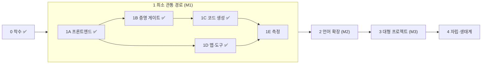

# BMB 로드맵

> 갱신: 2026-10-24 · 태스크 단위 진행은 `dev-docs/BACKLOG.md`에 있다.
> 설계는 `docs/DESIGN.md`, 결정 근거는 `dev-docs/adr/`.

## 운영 원칙

- **단계는 통과 기준으로 닫는다.** 기준은 측정할 수 있어야 하고, 측정 결과를 커밋해야 닫힌다. "약 95%" 같은 추정으로 닫지 않는다(genesis §3.5).
- **다음 단계는 앞 단계의 측정이 정한다.** 2단계 이후의 범위는 후보 목록이다. 1단계 측정 결과로 우선순위를 다시 정하고 ADR로 남긴다.
- **차별점 가설을 먼저 잰다.** 그 위에 기능을 쌓는 것은 측정 뒤다.
- **생태계는 마지막이다.** 원칙 4(증명이 테스트를 대체)와 원칙 6(도구 경유 접근)이 측정으로 입증되기 전에는 열지 않는다.

## 한눈에 보기

| 단계 | 목적 | 상태 |
| --- | --- | --- |
| 0 착수 | v0 정리, 설계·결정 문서 | 완료 |
| 1 최소 관통 경로 | "에이전트가 파일 없이, 테스트 없이, 증명된 코드를 쓴다"를 수십 개 정의 규모에서 측정 | 진행 중 (1A~1D 완료) |
| 2 언어 확장 | 1단계 측정이 가리킨 병목을 푼다. 실용 프로그램을 쓸 수 있는 언어 | 대기 |
| 3 대형 프로젝트 | 수천 개 정의 규모에서 탐색·증명 비용이 질의 범위에 비례함을 보인다 | 대기 |
| 4 자립·생태계 | 셀프호스팅 결정, 생태계 개방 | 대기 |

## 0단계: 착수 — 완료

- v0를 `legacy/v0` 브랜치로 보존하고 main을 비웠다(force push 없음).
- `docs/DESIGN.md` 확정본 v1, `dev-docs/v2-genesis.md`.
- ADR-0001~0015(착수 결정), ADR-0016(M1 범위).
- 남은 일: `v0.100-legacy` 태그는 이 환경에서 푸시가 막혀 GitHub에서 직접 만들어야 한다(백로그 0-04).

## 1단계: 최소 관통 경로 (M1)

범위는 ADR-0016이 정한다. 정수·슬라이스·루프·명세·효과 `pure`/`io`만으로 파싱부터 바이너리까지 관통한다.

### 1A 프론트엔드 — 완료

파싱, 이름·타입·소유권·명세 배치·효과 검사, JSONL 진단.

- **통과 기준(충족):** 진단 코드 51개 전부가 회귀 코퍼스에서 발생한다. 출력은 결정론적이다(같은 입력 → 같은 바이트). Rust 습관 진단(E02xx)은 수정 제안을 갖는다.

### 1B 증명 게이트 — 완료

검사를 통과한 코드에서 검증 조건(VC)을 만들어 Z3로 확인한다. 증명이 안 되면 바이너리가 없다.

- 정수 의미론과 인코딩을 먼저 ADR로 정한다. v0 `verify-vc`에서 흡수한 64비트 bitvector 인코딩이 출발점이다.
- 오버플로·0 나눗셈·인덱스 범위·`decreases` 감소·루프 불변식·호출 전제가 모두 증명 의무가 된다.
- 모듈 단위 assume-guarantee: 호출자는 callee의 `ensures`만 가정한다. `spec fn`은 기본 불투명이고 `#[uses(..)]`로 선언한 것만 펼친다.
- Z3는 SMT-LIB 텍스트로 프로세스에 넘기고 `rlimit`을 고정한다. unknown·timeout·솔버 부재는 실패다.
- 실패하면 반례를 구체 입력값으로 돌려준다.

**통과 기준**
1. `tests/check/ok`의 모든 정의가 증명된다.
2. 의도적으로 틀린 코퍼스(오버플로, 범위 밖, 약한 불변식, 감소하지 않는 `decreases`, 거짓 `ensures`)가 전부 거부되고, 각 거부에 반례나 실패 원인이 붙는다.
3. Z3를 치우면 빌드가 실패한다. `rlimit`을 바닥까지 낮추면 빌드가 실패한다.
4. 같은 입력이면 SMT 질의 텍스트가 바이트 단위로 같다.

**종료 감사(2026-10-24):** 기준 1은 `compiler/tests/verify.rs`의 `pass_corpus_is_proved`, 기준 2는 `fail_corpus_matches_expected`(위반 유형 23개, 모두 반례나 원인 포함), 기준 3은 `compiler/tests/gate.rs`, 기준 4는 `queries_and_output_are_deterministic`로 확인한다. 구현 중 결정은 ADR-0017·0018.

### 1C 코드 생성 — 완료

LLVM 텍스트 IR을 만들고 LLVM 도구로 바이너리를 만든다.

- 런타임 검사는 증명된 사실로만 지운다. 증명되지 않은 사실로는 `llvm.assume`을 내보내지 않는다(원칙 9).
- 모든 `&mut` 인자에 `noalias`를 붙인다(ADR-0015).

**통과 기준**
1. 예제 프로그램이 바이너리로 실행되고 기대한 출력을 낸다.
2. 증명된 인덱스 범위 사실 때문에 범위 검사가 IR에서 사라진 사례를 하나 이상 보인다. 같은 코드에서 증명을 빼면 검사가 남는 것도 보인다.
3. `llvm.assume`은 모두 증명된 사실에서 나온다. 검증 경로를 IR 주석으로 추적할 수 있다.

**종료 감사(2026-10-24):** 기준 1은 `compiler/tests/codegen.rs`의 `run_corpus_prints_expected_output`(Rust의 0 쪽 나눗셈·래핑 포함 8개 출력), 기준 2는 `proved_index_has_no_check_and_unproved_keeps_one`, 기준 3은 `mut_slices_are_noalias_and_shared_ones_readonly`(assume 미방출)와 IR의 `; proved Exxxx` 주석으로 확인한다. 증명된 사실은 현재 `nsw`/`nuw`/`inbounds`/`noalias`로 LLVM에 전달된다. assume 전달은 측정 후 결정한다(백로그 1C-07).

**관찰(1E-05·1E-08):** 7개 벤치에서 안전 Rust와 `get_unchecked` Rust의 속도 차이가 잡음 수준이었다. 간접 인덱스·길이 미상 슬라이스에서도 같았다. 이 벤치들에서는 증명 기반 검사 제거의 속도 이득이 보이지 않는다(`bench/baseline/results/2026-10-24.md`). 2단계 우선순위 결정(1E-07)의 입력이다.

**관찰:** M1에는 변환이 없어 `u64`·`usize` 값을 출력할 수 없다(`print_i64`만 있음). 2단계 "검사된 변환" 후보의 근거로 1E에서 빈도를 기록한다.

### 1D 맵과 도구 — 완료

에이전트가 파일을 열지 않고 도구로만 읽고 쓴다(원칙 6).

- 정규형 출력기(포매터)가 먼저다. 정의 해시와 파일 배치가 정규형 위에서 정의된다.
- 정의 단위 content hash, 표준 맵 L0~L2, ADR-0016의 읽기 질의 7개, 쓰기 트랜잭션 5개 + `build`.
- 노출은 MCP 서버와 CLI. 둘 다 같은 JSON을 낸다.

**통과 기준**
1. 같은 코드에서 맵과 모든 질의 출력이 두 번 실행해도 바이트 단위로 같다.
2. 파일 배치를 바꿔도(같은 정의를 다른 파일로 옮겨도) 맵과 해시가 그대로다.
3. 트랜잭션 커밋은 구조·타입 오류가 있으면 전체 거부된다. 증명 미완료 상태는 커밋되고 맵에 표시된다.
4. 정규형 왕복: 포매터 출력을 다시 포매팅하면 같은 바이트다.

**종료 감사(2026-10-24):** 기준 1·2는 `compiler/tests/map.rs`(`maps_are_deterministic_and_layout_independent`)와 `compiler/tests/fmt.rs`(해시의 배치·주석·순서 불변), 기준 3은 `compiler/tests/workspace.rs`와 `compiler/tests/mcp.rs`, 기준 4는 `formatting_is_idempotent`로 확인한다. 결정은 ADR-0019·0020. 에이전트는 `bmb mcp DIR`로 파일 없이 읽기(질의 7개)·쓰기(트랜잭션)·증명·빌드를 할 수 있다.

### 1E 측정 — 진행 중

M1의 가설을 숫자로 판정한다.

**현황(2026-10-24):** 절차(ADR-0021), 동결 과제 15개, 하네스와 실제 모델 어댑터, Rust 기준선(벤치 7개)이 준비되었다. 남은 것은 실제 모델 실행(백로그 1E-10, 사용자 머신)과 그 결과의 보고서(1E-06)·2단계 우선순위 ADR(1E-07)이다.

- 동결된 과제 집합(수십 개 정의 규모, 정수·배열 알고리즘)과 고정 프롬프트를 커밋한다.
- 측정 5종: 탐색 정확도, 질의당 토큰, 1회 성공률(재시도 없음), Rust 습관 오류율, 미증명 면적.
- Rust 기준선: v0 공정 하네스를 바탕으로 Rust(`get_unchecked` 변형 포함)와 성능을 잰다.

**통과 기준**
1. 측정 하네스, 과제, 프롬프트, 결과가 모두 커밋되어 있고 누구나 재현할 수 있다.
2. 결과 보고서가 과제 편향(정수·배열 한정)을 명시한다.
3. 결과로 2단계 우선순위를 정하는 ADR이 채택된다.

**1단계 종료 조건:** 1B~1E의 통과 기준을 모두 충족하고 측정 보고서가 커밋된 상태.

## 2단계: 언어 확장 (M2) — 후보

우선순위는 1E 결과로 정한다. 아래는 지금 보이는 후보다.

| 영역 | 후보 | 근거 |
| --- | --- | --- |
| 데이터 | 구조체, 열거형(`Option`·`Result`), 겹침 없는 명시적 impl | M1 과제에서 가장 먼저 걸릴 것으로 예상(ADR-0016) |
| 메모리 | 힙(`Vec`), 소유·이동 검사, 핸들·인덱스 패턴 | DESIGN.md §5 |
| 산술 | 검사된 변환, `checked_*`·`saturating_*` | DESIGN.md §4.1 |
| 효과 | `alloc`, `panic`, 비결정 효과 | 테스트 필요 면적 산출의 정밀도 |
| 근거 | 노드 해시에 묶인 구조화 근거 문법 | ADR-0006 |
| 탈출구 | `assume`·`external_body`와 근거 필수, 미증명 면적 집계 | DESIGN.md §4.1 |
| 빌드 | 해시 키 증명 캐시, 계약 방화벽 증분 빌드 | DESIGN.md §8.1 |
| 슬라이스 예산 | 계산·보고에서 빌드 거부로 승격 | 원칙 5, ADR-0016 O6 |
| 도구 | 기계적 표기 자동 채움, Rust 습관 자동 교정, 사전 영향 분석 | DESIGN.md §8.2 |
| 성능 | 증명 기반 검사 제거 확대, 효과 기반 최적화 | DESIGN.md §8.1 |

**통과 기준(초안):** 1E 과제보다 넓은 과제 집합에서 1단계 측정 5종이 악화되지 않는다. 추가한 기능마다 Rust 습관 오류율 변화를 보고한다.

## 3단계: 대형 프로젝트 (M3) — 후보

- 수천 개 정의 규모의 코드베이스에서 탐색 정확도와 질의당 토큰이 질의 범위에 비례함을 보인다(원칙 7).
- 확장 맵과 다중 관점 뷰(DESIGN.md §7.2), BMB 순수 함수로 쓴 확장 맵 생성기(ADR-0010).
- 대가 회수: 동등 규약 병합, 동형 함수 병합, 닫힌 세계 최적화(DESIGN.md §8.1).
- 도구: 해체·분할, 재조립·일반화, 재사용 검색, 계약 조정, 보존형 리팩터링(DESIGN.md §8.2).
- 설계서 도구(별도 리포, 마크다운 출력, ADR-0007).

## 4단계: 자립·생태계 — 후보

- 셀프호스팅 여부 결정(의미론이 안정된 뒤, ADR-0012).
- 패키지·바인딩 등 생태계. 원칙 4·6이 측정으로 입증된 뒤에만 연다.

## 결정이 필요한 쟁점 (ADR 후보)

| 쟁점 | 필요 시점 |
| --- | --- |
| 정수 의미론과 SMT 인코딩(bitvector 대 정수, 명세 산술의 범위) | 1B 착수 전 |
| 반례 출력 형식 | 1B |
| Z3 버전 고정과 `rlimit` 값 | 1B |
| 정규형(포매터) 규칙과 정의 해시의 정의 | 1D 착수 전 |
| 맵 JSON 스키마(L0~L2) | 1D |
| 슬라이스 크기 단위(토큰 계산 방식) | 1D |
| 측정 과제 집합과 프롬프트 동결 절차 | 1E 착수 전 |
| 2단계 우선순위 | 1E 종료 시 |
