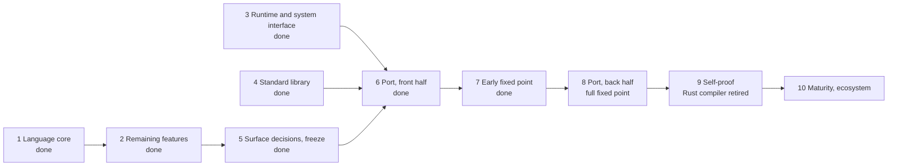
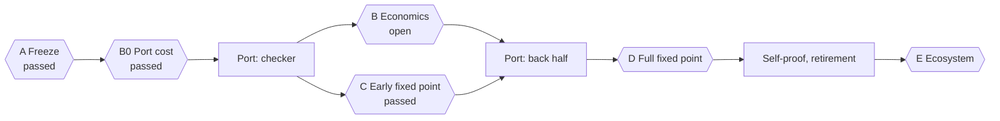

# BMB roadmap

This document says what BMB has to become, where it stands, and what comes next. The design is in [`DESIGN.md`](DESIGN.md), the reasons for decisions in [`adr/`](adr/), and the state of each claim in [`CLAIMS.md`](CLAIMS.md).

## Rules

- **A stage closes on a criterion.** The criterion is measurable and the stage closes when the measurement is committed, not on an estimate.
- **Claims are measured before anything is built on them.** A hypothesis that distinguishes BMB gets a minimal experiment first.
- **The proof gate is on from the start.** A feature that cannot be verified does not enter the language.
- **A large investment has a decision gate in front of it.** The action for each outcome is registered before the measurement. A verdict may be carried over to a later measurement once.
- **Benchmarks are committed with a fair baseline and their harness.** Tasks and prompts are frozen before the first run, and first-attempt success is reported without retries.
- **The ecosystem comes last.** Packages and bindings open only after the claims they rest on (proof replaces tests; access goes through tools) are shown by measurement.

## Mission

> With the same model and the same budget, code an agent writes in BMB has fewer defects than code it writes in Rust with tests, a higher first-attempt success rate than code it writes in a verified language (Verus), a navigation cost that does not grow with the codebase, and the performance of safe Rust.

| Goal | Measure | Target |
| --- | --- | --- |
| G1 Trust in the verdict | Known unfixed soundness violations and false counterexamples | 0 |
| G2 First-attempt correctness | Success rate of writing tasks, specification strength included | ≥ 60%; +10 points over Verus on the ported Verus tasks |
| G3 Specification quality | Share of hidden mutants the written specification rejects | ≥ 90% |
| G4 Navigation at scale | Tokens against file-based tools at 10,000 definitions, at equal accuracy | ≤ 1/3 |
| G5 Proof beats tests | Hidden defect rate and total tokens against Rust with tests | Defects ≤ 1/2; total tokens no more |
| G6 Performance | Run time against safe Rust | Within ±5% |
| G7 Cumulative verification cost | CPU time over a replayed commit history against Rust with test selection and caching | No more, at equal or better defect detection |
| G8 Least test code | Test code needed to pass the same hidden judge | ≤ 1/10 of Rust |
| G9 Least binary size | Stripped size against safe Rust (`panic=abort`) | ≤ 1/10 |

Where each goal stands is in [`CLAIMS.md`](CLAIMS.md).

## The whole sequence

A language that stands as "a proved systems language that agents write" has to pass ten layers. A layer closes only after the one before it, but work on them overlaps.

| Layer | Content | State |
| --- | --- | --- |
| 1 Language core | Integers, `bool`, functions, contracts, loops, data types, conversions, escape hatches, effects, `Vec` and moves, bytes, generics and traits, owned types and recursion, early exit, bit operations, proof functions, type invariants | Done |
| 2 Remaining features | `String`, `&str`, `char`; method syntax; `f64`; constants; closures | Done |
| 3 Runtime and system interface | Input, files and directories, processes with pipes, arguments and environment, monotonic clock, stack size, I/O errors; no FFI, a closed list of built-ins over libc | Done |
| 4 Standard library | Byte buffers and text, number formatting and parsing, sorted maps and sets, sorting, JSON, interning; all with contracts and proofs | Done (11 units) |
| 5 Surface decisions and freeze | The surface is settled before the port; the Rust compiler stops gaining features | Done (`0.1.0`) |
| 6 Port, front half | Lexer, parser, checker, normal form, identity hash, code generation in BMB. Each component closes when its command output is byte-identical to the Rust compiler's | Done: about 41,000 lines, every definition proved |
| 7 Early fixed point | The Rust compiler builds the port (stage 1); stage 1 builds it again (stage 2); stage 2 builds it again (stage 3); stage 2 IR = stage 3 IR | Done, checked on every commit |
| 8 Port, back half; full fixed point | Proof encoding and the solver connection, map, caches, tools, workspace, MCP, command line. Then the whole chain again with the whole compiler | In progress. Ported and byte-identical to the Rust compiler: proof encoding, the solver connection, the proving driver, the satisfiability tools, the stability check, the incremental cache, and code generation that drops proved checks. Left: map and queries, the read and write tools, workspace, MCP, the rest of the lint and of the command line; then the whole chain |
| 9 Self-proof; retirement | The BMB compiler passes its own proof gate under a bound on unproved area; the Rust compiler is frozen and kept as the seed | Not started |
| 10 Maturity and ecosystem | Specification and conformance tests, stability policy, reproducible builds, more targets, debug information, tools; packages and bindings | Reference and conformance tests exist; the rest waits |

## Decision gates

| Gate | Question | State |
| --- | --- | --- |
| A Freeze | Is the surface settled enough to port the compiler onto it? | Passed. The surface is frozen at `0.1.0` |
| B0 Port cost | Does the measured cost of the first components keep the whole port within the estimate? | Passed. The lexer and parser came to 1.00 times the Rust lines; the whole port is estimated at 66,000 to 75,000 lines |
| B Economics | On a real codebase (the Rust compiler and its BMB port as twins), does an agent understand, refactor and extend BMB at no more cost than Rust with tests? | **Carried over to gate D** ([ADR-0149](adr/0149-gate-b-verdict-carried-over.md)): it cannot be judged yet. Understanding meets its criterion once the BMB side has text search; task replay costs 1.07 to 1.30 times Rust in tokens with text search (one run; the interval contains 1), against 1.9 to 3.7 times without; refactoring was refuted on tokens without text search and has not been measured again. The verdict is made at gate D with the measurements that follow. See [`CLAIMS.md`](CLAIMS.md) |
| C Early fixed point | Does the ported front half build itself to a fixed point, and how fast is it? | Passed. Stage 1 checks its own source in 1.2 to 1.5 s against 1.1 s for the Rust compiler in release mode |
| D Full fixed point | Does the whole compiler build itself byte-identically and pass the whole gate, and do the claims hold at full size? | After layer 8 |
| E Ecosystem | Are the claims the ecosystem rests on shown? | After layer 9 |

Registered actions for gate B: if the claim holds, the port goes on as planned. If it is refuted, the back half does not start; the failure is attributed to a layer (language, compiler, tools, harness) and a direction is decided: repair that layer and measure once more, revise the premise, or limit the claims to what was shown. If it cannot be judged, the verdict is carried to gate D once.

## Now

1. **Port the back half, proof encoding first.** Gate B was carried over to gate D ([ADR-0149](adr/0149-gate-b-verdict-carried-over.md)), so the port goes on. The encoder's tables view, term builders, the encoding of specification terms and axioms, the encoding of executable and proof bodies (loops, proof code, the operations of `Vec` and text) the sub-proofs of `assert .. by` and query assembly (the scripts the solver receives before its first answer, in canonical symbols with their legends) are ported and compared with the Rust compiler byte for byte (`bmb dump smt-decls`, `bmb dump smt`, `bmb dump smt-queries`: every definition of every tracked program, the port itself included). The solver connection (the Z3 process, its limits, the answers read back and the replay of a query at the memory limit) is ported too and compared by sending the same scripts through both connections, to the pinned Z3 and to a stand-in that records every byte it is sent. The proving driver is ported too: `bmb verify` of the port gives the same status rows, diagnostics, counterexamples, exit code and `--emit-smt` scripts (every query, the retries after an answer included) as the Rust compiler, with and without the proof cache, and the port verifies itself with the same bytes (compared every night, with the other comparisons too long for the per-push gate). The satisfiability tools are ported too: `bmb examples` and `bmb lint --select` of the checks that ask whether facts of the prover's encoding can hold together (preconditions that cannot, a contract with two results for one input, points a proof cannot reach) and of the precondition a proof does not need, with the same rows and every byte sent to a stand-in solver, and so is `bmb stability` (the proof under each solver seed, with the verdicts and resource units per definition). The proof side of the incremental cache of whole definitions is ported too (`verify --cache DIR`, with `--def` and `--audit`, and the lint's first verification): the same stats and the same cache file below the line that names the compiler build, whose keys name neither the definitions nor the build, and a cache of another build is not read. The port's `emit-llvm` and `build` prove first as the Rust compiler does: without `--all-checks` the runtime check of an obligation is dropped only where its proof is usable (no failure among the definitions connected to its own by calls, no trusted facts beneath it), `build` refuses a program that is not fully proved and runs clang, and the IR side of that cache is ported with them: the same entries, the same reuse after each kind of edit and the same stats, the count of checks kept included. The other checks of `lint` and `weaken` come with the tools.
2. **Prepare the gate D measurement.** What it must bring is listed in ADR-0149: enough history tasks for an interval, three runs of the reference model, tasks drawn anew at full size, refactoring under the current tools.
3. **Finish the repository split.** The benchmarks, their harnesses, frozen sets and result rows are in [`bmb-bench`](https://github.com/lang-bmb/bmb-bench), which checks itself against a checkout of this repository. The programs the compiler's own tests read stay here as `tests/corpus`. Still to move: the measurement reports, in English.

Open work beside these: the remaining gap between stage 1 and the Rust compiler (1.1 to 1.3 times), insertion cost of the standard library's sorted maps, incremental proof keys that read a type by field rather than whole.

## Later

- Reproducible builds, a second target (aarch64), DWARF line information.
- A release procedure: version tags, binaries, a change log.
- A documentation generator from the map; a runner for the test area the compiler reports as not covered by proof.
- The decision on opening packages and bindings (gate E).
